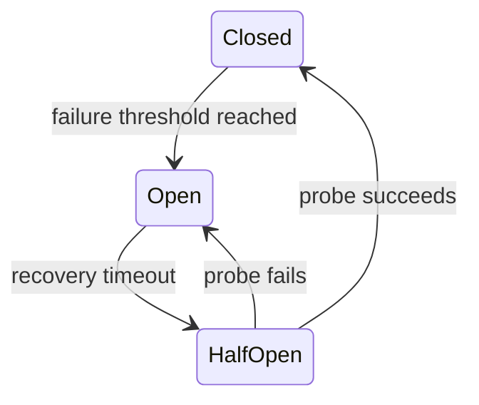

## Definition

Circuit Breaker 在下游持续失败时暂时停止调用，让请求快速失败或走安全降级路径，避免资源耗尽和级联故障。这个模式由 Michael Nygard 在《Release It!》中推广。

## Key Terms

| 中文 | English | 含义 |
| --- | --- | --- |
| 断路器 | Circuit Breaker | 下游持续失败时暂时停止调用的保护机制 |
| 关闭 / 打开 / 半开 | Closed / Open / Half-Open | 断路器的三种状态 |
| 失败阈值 | Failure Threshold | 触发打开状态的失败数 |
| 级联故障 | Cascading Failure | 一个依赖的故障沿调用链扩散 |
| 快速失败 | Fail Fast | 不发起调用，直接返回错误 |
| 降级响应 | Fallback | 下游不可用时返回的安全替代结果 |

## States

- **Closed**：正常放行请求，并记录最近的失败次数。失败计数是基于时间的，会定期重置，所以偶发失败不会让断路器打开。
- **Open**：暂时阻止调用，直接返回错误或降级响应，同时启动超时计时器。计时器到期后进入 Half-Open。
- **Half-Open**：允许有限数量的请求通过，探测下游是否恢复。连续成功达到阈值后回到 Closed 并重置失败计数；任意一次失败就立刻回到 Open 并重启计时器。

Half-Open 的作用是避免刚恢复的服务被突然涌入的请求再次压垮。

## Design Considerations

- 监控：断路器本身要暴露成功和失败请求，便于判断系统健康。
- 恢复策略：Open 持续太久，即使故障已恢复仍会继续报错；从 Open 切到 Half-Open 太快，会让响应时间波动。
- 也可以不用计时器，而是定期 ping 下游或调用其健康检查接口，来决定何时进入 Half-Open。
- 恢复时间不确定时，提供手动重置或强制打开的选项。

## Gotchas

- Circuit Breaker 不是 [[Retry|重试]] 的替代品；两者需要共同的超时和重试预算。
- AWS Builders' Library 指出，断路器会给系统引入难以测试的 modal behavior（不同状态下行为不同），并可能显著拉长恢复时间；AWS 更倾向于用本地 token bucket 限制重试来控制负载。这是一种取舍，不是对错。
- 对关键校验（例如风险、权限检查），不能为了“可用”而绕过必要检查。
- 是否返回错误、降级响应或接受为 Pending 是业务决策。

## Connections

### Supports
- [[High Availability]]
- [[Graceful Degradation]]

### Related mechanisms
- [[Retry]]
- [[Exponential Backoff and Jitter]]

## Sources

- [Martin Fowler — Circuit Breaker](https://martinfowler.com/bliki/CircuitBreaker.html)
- [Azure Architecture Center — Circuit Breaker pattern](https://learn.microsoft.com/en-us/azure/architecture/patterns/circuit-breaker)
- [AWS Builders' Library — Timeouts, retries, and backoff with jitter](https://aws.amazon.com/builders-library/timeouts-retries-and-backoff-with-jitter/)
