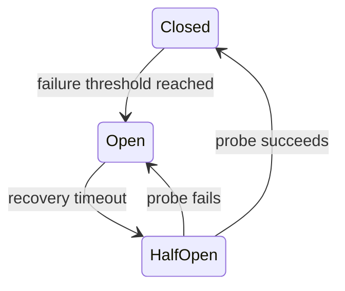

## Definition

Circuit Breaker 在下游持续失败时暂时停止调用，让请求快速失败或走安全降级路径，避免资源耗尽和级联故障。

## States

- **Closed**：正常放行请求并记录结果。
- **Open**：暂时阻止调用。
- **Half-Open**：允许少量探测请求判断是否恢复。

## Gotchas

- Circuit Breaker 不是 [[Retry|重试]] 的替代品；两者需要共同的超时和重试预算。
- 金融风险检查失败时不能为了“可用”而绕过必要校验。
- 是否返回错误、降级响应或接受为 Pending 是业务决策。

## Connections

### Supports
- [[High Availability]]
- [[Graceful Degradation]]

### Related mechanisms
- [[Retry]]
- [[Exponential Backoff and Jitter]]

