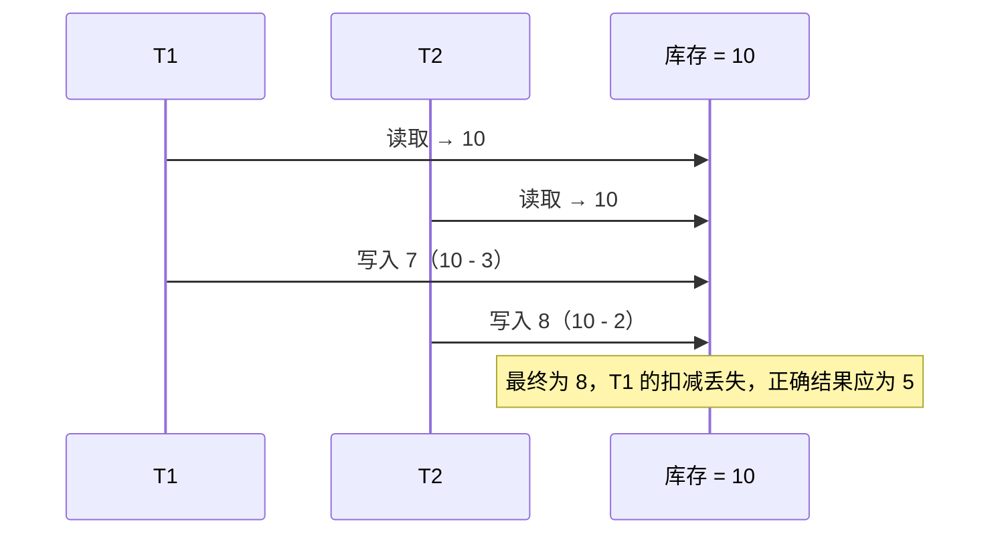

## Definition

Concurrency Control 负责协调同时发生的操作，使最终结果仍满足 [[Data Invariant|业务不变量]]。

## Key Terms

| 中文 | English | 含义 |
| --- | --- | --- |
| 并发控制 | Concurrency Control | 协调同时发生的操作，使结果仍满足业务不变量 |
| 丢失更新 | Lost Update | 后提交的写入覆盖了先前结果 |
| 检查时间到使用时间 | TOCTOU（Time-of-check to Time-of-use） | 检查条件和实际使用之间状态已改变 |
| 写偏斜 | Write Skew | 并发事务各自合法，组合结果破坏跨记录约束 |
| 悲观锁 / 乐观锁 | Pessimistic / Optimistic Locking | 提前加锁阻止冲突 / 提交时检测冲突 |
| 唯一约束 | Unique Constraint | 数据库保证某些列的值不重复 |

## Common Problems

- **Lost update**：后提交的写入覆盖了先前结果。
- **TOCTOU**：检查条件和实际使用之间，状态已经改变。
- **Write skew**：两个事务分别看到合法状态，组合结果却破坏跨记录约束，见 [[Snapshot Isolation]]。
- **Duplicate effects**：同一业务操作因重试被执行多次。

## Example: Lost Update

两个事务各自都“正确”，问题在于它们基于互相过期的状态提交。

## Common Techniques

- [[Atomic Operation|原子条件更新]]：`UPDATE ... SET stock = stock - 3 WHERE stock >= 3`
- [[Optimistic Locking|版本号和条件写入]]
- 行锁或显式悲观锁
- 唯一约束
- 数据库事务与合适的 [[Transaction Isolation|隔离级别]]
- [[Idempotency|幂等处理]]

## Gotchas

请求在网络上同时到达并不是问题本身；问题是系统是否允许它们基于互相过期的状态同时提交。

## Connections

### Broader concepts
- [[Consistency]]
- [[Data Invariant]]

### Implementations
- [[Amazon DynamoDB]]
- [[Database]]

### Models
- [[Serializability]]
- [[Snapshot Isolation]]

### Case study
- [[Order Processing Consistency Case Study]]
