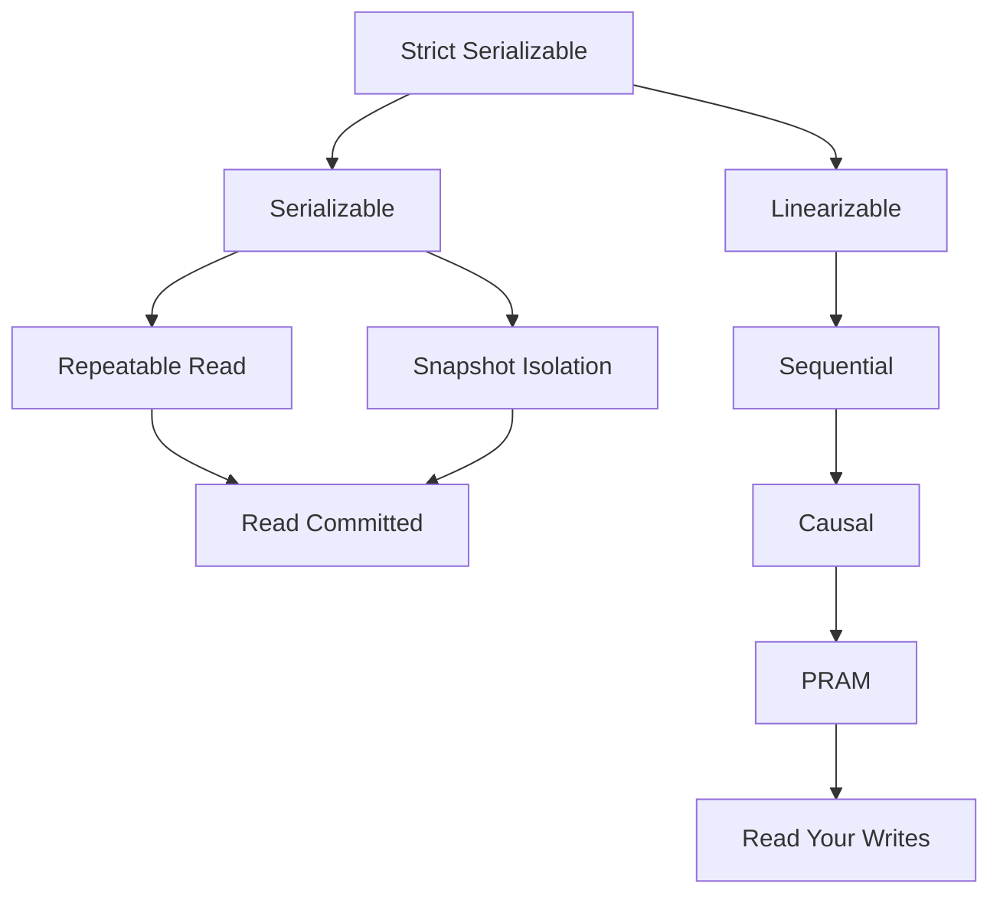

## Definition

Consistency Model（一致性模型）规定：多个进程并发读写同一个系统时，哪些「操作历史」是允许出现的。模型越强，允许的历史越少，程序员需要处理的意外越少，但可用性和延迟的代价通常越高。

“模型 x implies 模型 y”表示：每一个满足 x 的历史也满足 y，即 x 更强。

## Key Terms

| 中文 | English | 含义 |
| --- | --- | --- |
| 一致性模型 | Consistency Model | 规定哪些操作历史是允许的 |
| 蕴含 | Implies | x 蕴含 y：满足 x 的历史都满足 y，x 更强 |
| 线性一致 | Linearizable | 单对象、符合实时顺序 |
| 顺序一致 | Sequential Consistency | 存在总顺序，且与每个进程自己的顺序一致 |
| 因果一致 | Causal Consistency | 有因果关系的操作在所有进程上顺序相同 |
| 读己之写 | Read Your Writes | 进程总能读到自己之前的写入 |
| 可串行化 | Serializable | 事务像按某个总顺序执行 |
| 快照隔离 | Snapshot Isolation | 每个事务读自己的一致快照 |
| 可重复读 | Repeatable Read | 已读过的对象保持稳定 |
| 读已提交 | Read Committed | 不读取未提交数据 |
| 完全可用 / 粘性可用 | Totally Available / Sticky Available | 每个未故障节点都能服务 / 客户端固定连同一服务器时能服务 |

## Two Families

[Jepsen 的一致性模型图](https://jepsen.io/consistency/models)把模型分成两族：

- **单对象模型**：描述对单个对象（例如一个 key）的操作顺序，如 [[Linearizability]]、Sequential、Causal。
- **多对象事务模型**：描述包含多次读写、可能跨多个对象的事务，如 [[Serializability]]、[[Snapshot Isolation]]、Repeatable Read、Read Committed。

[[Serializability#Strict Serializability|Strict Serializable]] 同时蕴含 Serializable 和 Linearizable，把两族统一起来。

箭头表示 implies。图中省略了 Cursor Stability、Monotonic Atomic View、Monotonic Reads/Writes、Writes Follow Reads 等中间模型。Repeatable Read 与 Snapshot Isolation 之间没有箭头，表示二者互不蕴含。

## Models at a Glance

| 模型 | 一句话 | 要求实时顺序 | 分区时的可用性（Jepsen） |
| --- | --- | --- | --- |
| Strict Serializable | 事务像按某个总顺序执行，且顺序符合实时先后 | 是 | 不能 totally 或 sticky available |
| Linearizable | 单对象操作各自像在调用与完成之间的某一刻原子生效，符合实时顺序 | 是 | 不能 totally 或 sticky available |
| Serializable | 事务像按某个总顺序执行 | 否 | 不能 totally 或 sticky available |
| Snapshot Isolation | 每个事务读取自己的一致快照，允许 write skew | 否 | 不能 totally available |
| Repeatable Read | 已读过的对象保持稳定，允许 phantom | 否 | 不能 totally available |
| Sequential | 存在总顺序，并与每个进程自己的操作顺序一致 | 否 | 不能 totally 或 sticky available |
| Causal | 有因果关系的操作在所有进程上顺序一致 | 否 | sticky available |
| Read Your Writes | 进程总能读到自己之前的写入 | 否 | sticky available |
| Read Committed | 不读取未提交数据 | 否 | 可以 totally available |

- **Totally available**：每个未故障节点都能处理请求。
- **Sticky available**：客户端始终连接同一个服务器时，每个未故障节点上的客户端都能继续工作。

## How to Choose

1. 先写出 [[Data Invariant|业务不变量]]，再选模型。
2. 不变量只涉及单个 key，还是跨多个 key？
3. 是否必须保证“A 完成之后 B 才开始，则 B 必须看到 A”这种实时关系？
4. 网络分区时，是拒绝请求（更强模型），还是继续服务但接受冲突和旧数据（更弱模型）？

## Gotchas

- “Strong consistency” 在不同语境下指不同的模型，使用前要追问是 Linearizability 还是 Serializability，见 [[Consistency]]。
- 数据库产品的隔离级别名称与这张图不完全对应。例如 PostgreSQL 的 Repeatable Read 实际是 Snapshot Isolation，见 [[Transaction Isolation]]。
- 一致性模型只约束客户端能观察到的历史，不规定怎样实现。

## Connections

### Single-object models
- [[Linearizability]]

### Transactional models
- [[Serializability]]
- [[Snapshot Isolation]]
- [[Transaction Isolation]]

### Related concepts
- [[Consistency]]
- [[CAP Theorem]]

## Sources

- [Jepsen — Consistency Models](https://jepsen.io/consistency/models)
- [Jepsen — Sequential Consistency](https://jepsen.io/consistency/models/sequential)
- [Jepsen — Causal Consistency](https://jepsen.io/consistency/models/causal)
- [Jepsen — Read Your Writes](https://jepsen.io/consistency/models/read-your-writes)
- [Jepsen — Repeatable Read](https://jepsen.io/consistency/models/repeatable-read)
