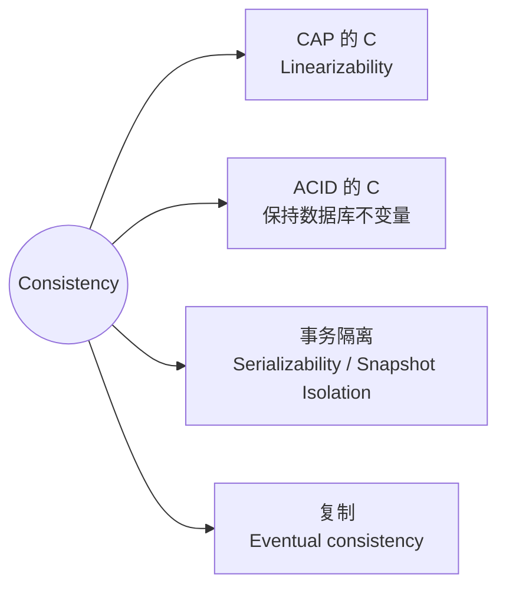

## Definition

Consistency 描述多个读取者、写入者或服务在什么条件下能观察到彼此的更新。它不是一个单一开关；不同一致性模型提供不同保证。

## Key Terms

| 中文 | English | 含义 |
| --- | --- | --- |
| 一致性 | Consistency | 多个读写者在什么条件下能观察到彼此的更新 |
| 线性一致性 | Linearizability | 单对象操作符合实时顺序 |
| 最终一致性 | Eventual Consistency | 没有新更新后，副本最终收敛 |
| 读己之写 | Read-Your-Writes | 进程能读到自己之前的写入 |
| 强一致 | Strong Consistency | 含义因语境而异，需追问具体模型 |
| 不变量 | Invariant | 在所有合法状态下都成立的规则 |

## Where the Word Comes From

## Common Meanings of "Consistency"

同一个词在不同语境里指向不同的东西，讨论前要先确认是哪一种：

| 语境 | 指的是 | 保证什么 | 笔记 |
| --- | --- | --- | --- |
| CAP 中的 C | Linearizability | 单个对象的操作按实时顺序原子生效 | [[CAP Theorem]]、[[Linearizability]] |
| ACID 中的 C | 保持数据库不变量 | 事务只能把数据库从一个满足规则的状态带到另一个满足规则的状态 | [[Data Invariant]]、[[Atomic Operation]] |
| 事务隔离 | Serializability、Snapshot Isolation 等 | 多对象事务并发后的结果是否等价于某种串行顺序 | [[Serializability]]、[[Snapshot Isolation]]、[[Transaction Isolation]] |
| 复制 | Eventual consistency | 副本最终收敛 | 本文 |

CAP 中的 C 与 ACID 中的 C 不是同一个概念：前者约束的是读写在副本间的可见顺序，后者约束的是事务是否破坏数据规则。

## Common Models

完整的强弱关系见 [[Consistency Models]]。

- **Linearizability**：单对象操作符合实时顺序。使用“强一致”这个词时，应追问它指的是 Linearizability 还是 Serializability。
- **Eventual consistency**：如果某个数据项不再有新的更新，最终所有读取都会返回最后一次更新的值，副本因此收敛。这是一个很弱的保证；更强的模型（例如 Linearizability）自然也满足它。
- **Read-your-writes**：进程执行写入后，它自己随后的读取必须看到这次写入的效果。它不保证其他进程也能看到。

业务应先定义 [[Data Invariant|数据不变量]]，再选择一致性模型。例如资金预留不能基于过期购买力，而非关键报表通常可以接受有界延迟。

## Gotchas

- “最终一致”不代表没有期限地不一致；需要定义延迟目标和恢复机制。
- 强一致不等于整个系统必须同步执行。
- 用户界面中的状态应区分 Pending、Confirmed 和 Failed，避免把暂时状态展示为最终事实。

## Connections

### Theory
- [[Consistency Models]]
- [[CAP Theorem]]
- [[Linearizability]]
- [[Serializability]]
- [[Snapshot Isolation]]
- [[Transaction Isolation]]

### Enforced by
- [[Atomic Operation]]
- [[Concurrency Control]]
- [[Idempotency]]

### Case studies
- [[Order Processing Consistency Case Study]]
- [[Reconciliation]]

## Sources

- [Jepsen — Consistency Models](https://jepsen.io/consistency/models)
- [Jepsen — Read Your Writes](https://jepsen.io/consistency/models/read-your-writes)
- [Wikipedia — ACID: Consistency](https://en.wikipedia.org/wiki/ACID#Consistency)
- [Wikipedia — Eventual consistency](https://en.wikipedia.org/wiki/Eventual_consistency)
