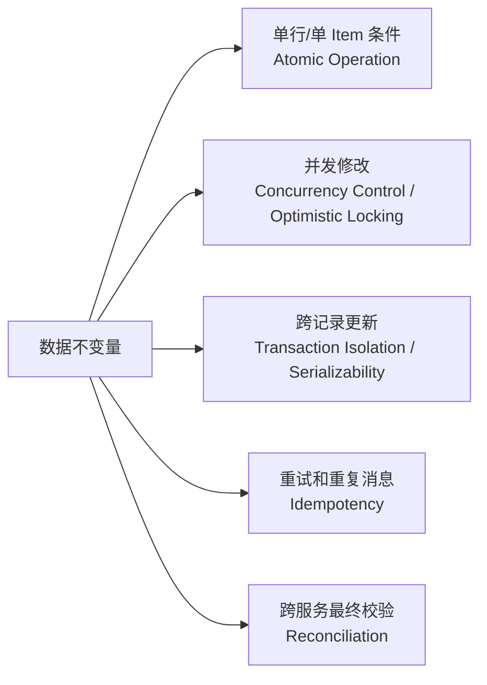

## Definition

Data Invariant（数据不变量）是在所有合法系统状态中都必须成立的业务规则。

示例：

- 库存数量不能因并发扣减而小于零。
- 同一个事件 ID 不能让账户余额或持仓重复增加。
- 已取消订单不能重新进入已提交状态，除非业务状态机明确允许。

## Key Terms

| 中文 | English | 含义 |
| --- | --- | --- |
| 数据不变量 | Data Invariant | 所有合法系统状态中都必须成立的业务规则 |
| 业务规则 | Business Rule | 业务对数据的约束，例如库存不能为负 |
| 状态机 | State Machine | 规定状态之间允许的转换 |
| 对账 | Reconciliation | 与权威来源比较并修复差异 |

## Invariant First, Then Mechanism

## Why It Matters

技术选型应从不变量开始，而不是先选择数据库、队列或 Kubernetes。系统可以暂时延迟展示，但不能破坏核心资金和订单规则。

## Enforcement

- 单行或单 Item 条件：[[Atomic Operation]]
- 并发修改：[[Concurrency Control]]、[[Optimistic Locking]]
- 跨记录更新：[[Transaction Isolation]]、[[Serializability]]
- 重试和重复消息：[[Idempotency]]
- 跨服务最终校验：[[Reconciliation]]

## Connections

### Related concepts
- [[Consistency]]
- [[Reliability]]

### Case study
- [[Order Processing Consistency Case Study]]
