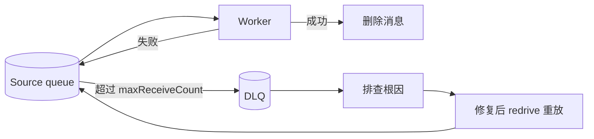

## Definition

Dead Letter Queue（DLQ）用于隔离经过规定处理尝试后仍无法成功消费的消息。

DLQ 不是 Worker 失败后的固定“下一站”，也不代表问题已经解决。消息何时进入 DLQ 取决于具体队列的 redrive、receive count、visibility timeout 和消费者行为。

## Key Terms

| 中文 | English | 含义 |
| --- | --- | --- |
| 死信队列 | Dead Letter Queue（DLQ） | 隔离多次处理失败的消息 |
| 毒消息 | Poison Message | 反复处理都会失败的消息 |
| 重驱动 | Redrive | 把消息从 DLQ 移回源队列重新处理 |
| 接收次数 | Receive Count | 消息被消费者接收的次数 |
| 最大接收次数 | `maxReceiveCount` | 超过该次数后消息被移入 DLQ |
| 重放 | Replay | 修复根因后重新处理消息 |

## Message Path to the DLQ and Back

## How It Works in SQS

- Redrive policy 里的 `maxReceiveCount` 指消息被消费者接收多少次之后会被移入 DLQ。设置过低（例如 1），一次接收失败就会进入 DLQ；应设得足够高，留出足够的重试机会。
- DLQ 必须与源队列在同一个 AWS 账号和 Region，并且要先创建队列，再把它配置为 DLQ。
- 不要给要求严格保序的 FIFO 队列使用 DLQ，否则会打乱消息或操作的顺序。
- 标准队列中，消息移入 DLQ 时入队时间戳不变，所以消息的过期时间始终从原始入队时间算起。
- 可以用 DLQ redrive 把消息移出 DLQ，重新处理。

## Operational Workflow

1. 对 DLQ 消息数量和增长速率告警。
2. 区分暂时故障、代码缺陷和永久性坏数据；检查异常日志、消息内容，以及消费者的处理时间是否足够。
3. 修复根因。
4. 在满足 [[Idempotency|幂等性]] 的前提下安全重放。
5. 通过 [[Reconciliation|对账]] 确认没有遗漏或重复效果。

## Gotchas

- 不应把 DLQ 当作长期存储。
- 无限制重放会重新制造故障。
- 批处理消费者需要避免一个 poison message 让已成功消息反复处理。

## Connections

### Failure handling
- [[Retry]]
- [[Delivery Semantics]]

### Implementations
- [[Amazon SQS]]
- [[Reliable Asynchronous Processing]]

## Sources

- [Amazon SQS — Using dead-letter queues](https://docs.aws.amazon.com/AWSSimpleQueueService/latest/SQSDeveloperGuide/sqs-dead-letter-queues.html)
