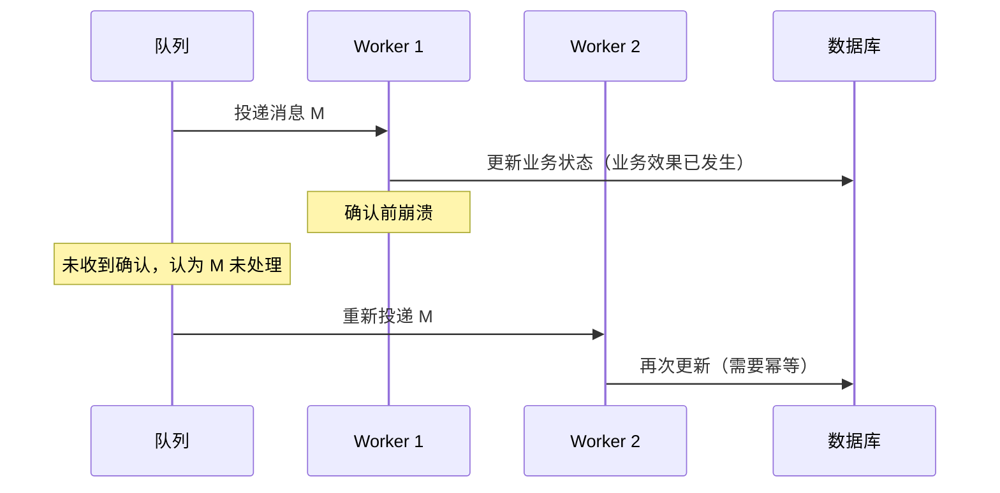

## Definition

Delivery Semantics 描述消息或请求在失败和重试条件下可能被传递多少次。

| 模型 | 可能丢失 | 可能重复 | 典型要求 |
| --- | --- | --- | --- |
| At-most-once | 是 | 否 | 不重试或先确认后处理 |
| At-least-once | 尽量避免 | 是 | 消费者必须幂等 |
| Exactly-once effect | 业务效果不重复 | 传递仍可能重复 | 应用层幂等、唯一约束和事务 |

“Exactly-once delivery”通常不能只靠消息中间件端到端实现。Worker 可能在更新数据库后、确认消息前崩溃，消息因此再次出现。

## Key Terms

| 中文 | English | 含义 |
| --- | --- | --- |
| 投递语义 | Delivery Semantics | 失败和重试下消息可能被传递多少次 |
| 至多一次 | At-most-once | 可能丢失，不会重复 |
| 至少一次 | At-least-once | 不丢失，但可能重复 |
| 恰好一次效果 | Exactly-once Effect | 投递可能重复，但业务效果只发生一次 |
| 确认 | Acknowledgment（Ack） | 消费者告知队列处理完成 |
| 重复投递 | Duplicate Delivery | 同一条消息被投递多次 |

## Why Duplicates Happen

超时和失败也不代表副作用没有发生：请求可能已经成功，只是响应丢了。AWS Builders' Library 的建议是把 API 设计成幂等的，这样才能安全重试。

## Scope Matters

有些系统声明了 exactly-once 的保证，但它只覆盖系统自己的边界。例如 Amazon SQS 的 Standard 队列提供 at-least-once 投递，FIFO 队列支持 exactly-once 的消息处理。边界之外（消费者写入自己的数据库、调用外部 API）仍然需要幂等设计，见 [[Amazon SQS]]。

## Connections

### Implemented with
- [[Idempotency]]
- [[Atomic Operation]]
- [[Transaction Isolation]]

### Failure handling
- [[Retry]]
- [[Dead Letter Queue]]

### Implementations
- [[Amazon SQS]]
- [[Reliable Asynchronous Processing]]

## Sources

- [Amazon SQS — What is Amazon SQS](https://docs.aws.amazon.com/AWSSimpleQueueService/latest/SQSDeveloperGuide/welcome.html)
- [AWS Builders' Library — Timeouts, retries, and backoff with jitter](https://aws.amazon.com/builders-library/timeouts-retries-and-backoff-with-jitter/)
