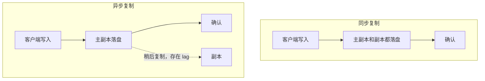

## Definition

Durability 描述已经被系统确认持久化的数据，在进程、节点或基础设施故障后仍能保留的能力。

## Key Terms

| 中文 | English | 含义 |
| --- | --- | --- |
| 持久性 / 耐久性 | Durability | 已确认持久化的数据在故障后仍能保留 |
| 可用性 | Availability | 现在能不能访问数据 |
| 复制 | Replication | 把数据保存多个副本 |
| 同步 / 异步复制 | Synchronous / Asynchronous Replication | 确认前 / 确认后才复制到副本 |
| 复制延迟 | Replication Lag | 异步复制中副本落后主副本的时间 |
| 备份 | Backup | 可恢复到历史状态的独立副本 |
| 时间点恢复 | PITR（Point-in-Time Recovery） | 恢复到过去某个时刻的状态 |
| 版本控制 | Versioning | 保留对象的历史版本 |
| 校验和 | Checksum | 用来验证数据完整性 |

## Synchronous vs Asynchronous Replication

## Durability vs Availability

两者回答不同的问题：

- Durability：数据会不会丢。
- [[High Availability|Availability]]：现在能不能访问。

Amazon S3 是很好的例子：S3 Standard 设计目标是 99.999999999%（11 个 9）的对象耐久性和 99.99% 的可用性；不同存储类别的耐久性目标相同，但可用性目标不同（例如 S3 One Zone-IA 是 99.5%）。数据完好无损但暂时读不到，是可用性问题；读得到但内容已损坏或丢失，才是耐久性问题。

## How Systems Achieve It

- **多副本**：S3 把对象冗余存储在至少三个可用区的多个设备上（One Zone-IA 除外，它只在单个可用区内冗余）。
- **完整性校验**：S3 使用校验和定期验证静态数据，并在发现冗余丢失时快速检测和修复。
- **确认时机**：写入被确认之前，数据必须已经落到足够多的副本或持久化介质上，否则“已确认”就没有意义。同步复制能在确认前保证副本落盘，异步复制则有 replication lag，可能丢最近的写入，见 [[Recovery Point Objective]]。

## Replication Is Not Backup

- Replication 可以提高可用性并降低单节点丢失风险。
- 错误删除、逻辑损坏和恶意操作也可能被复制。
- Backup、版本控制和 Point-in-Time Recovery 用于恢复历史状态。例如 S3 Versioning 可以恢复被误删或误覆盖的对象版本。

因此，复制、备份、恢复演练和恢复后正确性验证解决的是不同问题。

## Connections

### Distinguished from
- [[High Availability]]
- [[Reliability]]

### Recovery
- [[Disaster Recovery]]
- [[Recovery Point Objective]]

### Data correctness
- [[Reconciliation]]

## Sources

- [Amazon S3 — Data protection](https://docs.aws.amazon.com/AmazonS3/latest/userguide/DataDurability.html)
- [Amazon S3 FAQs — durability and availability by storage class](https://aws.amazon.com/s3/faqs/)
