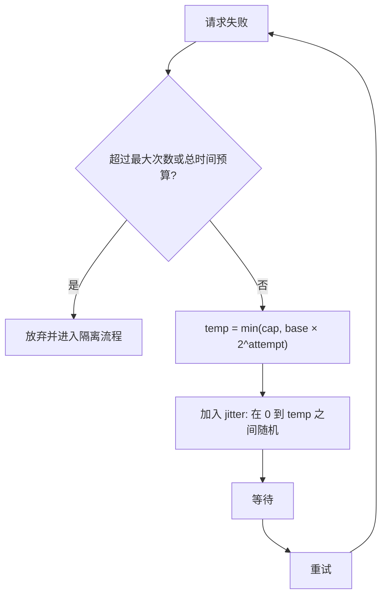

## Definition

Exponential Backoff 让连续重试之间的等待时间逐步增加；Jitter 在等待时间中加入随机扰动，避免大量客户端同时重试。

示意：

```text
1s → 2s → 4s → 8s
```

实际实现通常还需要最大等待时间（cap，即 capped exponential backoff）、最大尝试次数和随机化策略。

## Key Terms

| 中文 | English | 含义 |
| --- | --- | --- |
| 指数退避 | Exponential Backoff | 重试间隔按指数增长 |
| 抖动 | Jitter | 给等待时间加入随机扰动 |
| 惊群 | Thundering Herd | 大量客户端同时重试，再次压垮下游 |
| 退避上限 | Cap | 等待时间的最大值 |
| 全抖动 | Full Jitter | 等待时间在 0 到 temp 之间随机 |
| 均等抖动 | Equal Jitter | 保留一半退避，另一半随机 |
| 去相关抖动 | Decorrelated Jitter | 随机范围依赖上一次的等待时间 |

## Retry Loop with Backoff and Jitter



## Why Jitter Matters

只有指数退避并不够。AWS 架构博客的模拟发现，指数退避让调用越来越稀疏，但仍然聚集成簇：原本竞争的客户端只是被推迟到同一批时间点，争用并没有明显减少。

如果大量 Worker 在相同时间失败并按完全相同的间隔重试，它们会同时再次冲击下游，形成 Thundering Herd。随机扰动可以把请求分散到不同时间。

## Three Jitter Variants

令 `temp = min(cap, base * 2^attempt)`：

| 变体 | 等待时间 | 特点 |
| --- | --- | --- |
| Full Jitter | `random(0, temp)` | 工作量最少，耗时略长 |
| Equal Jitter | `temp/2 + random(0, temp/2)` | 保留一半退避，避免过短的等待；工作量与 Full 相近，但耗时更长 |
| Decorrelated Jitter | `min(cap, random(base, prev_sleep * 3))` | 随机范围依赖上一次的等待；工作量比 Full 和 Equal 更高 |

在 AWS 的模拟中，没有 jitter 的指数退避工作量和耗时都最差；三种 jitter 都大幅降低了客户端工作量和服务端负载。Full 与 Decorrelated 之间的取舍不明显。博客还指出，这些方法没有改变工作量随竞争 N² 增长的本质，但在合理竞争水平下显著减少了工作量。

## Jitter Beyond Retries

流量往往有突发，周期性任务（每分钟一次、每天零点）也会在多台服务器上对齐。AWS Builders' Library 建议对定时器、周期性任务和延迟任务也加 jitter。

## Gotchas

- Backoff 不能代替限流和容量管理。
- 长时间重试会增加用户可见延迟，必须有总时间预算。
- 对非幂等操作重试可能产生重复副作用，见 [[Idempotency]]。
- 多个调用层各自重试会成倍放大负载，见 [[Retry]]。

## Connections

### Technique for
- [[Retry]]

### Protected by
- [[Idempotency]]

### Related mechanisms
- [[Circuit Breaker]]
- [[Dead Letter Queue]]
- [[Optimistic Locking]]

## Sources

- [AWS Architecture Blog — Exponential Backoff and Jitter](https://aws.amazon.com/blogs/architecture/exponential-backoff-and-jitter/)
- [AWS Builders' Library — Timeouts, retries, and backoff with jitter](https://aws.amazon.com/builders-library/timeouts-retries-and-backoff-with-jitter/)
- [AWS SDK retry behavior](https://docs.aws.amazon.com/sdkref/latest/guide/feature-retry-behavior.html)
