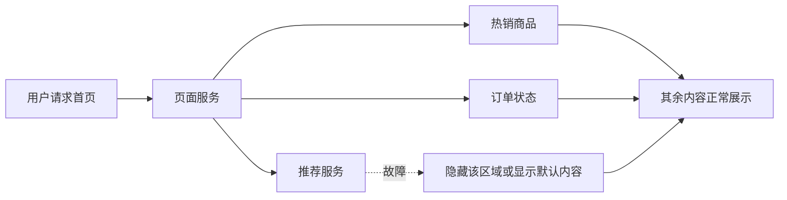

## Definition

Graceful Degradation 表示部分功能或依赖故障时，系统仍提供安全、明确且能力受限的服务，而不是让所有功能一起失败。AWS Well-Architected 把它概括为：把适用的硬依赖变成软依赖。依赖不可用时，组件可能返回稍旧的数据、替代数据，甚至不返回数据，但核心功能继续运行。

## Key Terms

| 中文 | English | 含义 |
| --- | --- | --- |
| 优雅降级 | Graceful Degradation | 部分依赖故障时仍提供受限但安全的服务 |
| 硬依赖 / 软依赖 | Hard / Soft Dependency | 依赖失败会导致整体失败 / 失败可被补偿 |
| 核心路径 | Core Path | 必须保持可用的核心业务功能 |
| 降级模式 | Degraded Mode | 能力受限的运行状态 |
| 待定状态 | Pending | 暂时无法确认的状态，稍后再处理 |

## Home Page with One Failing Dependency

## Examples

- 推荐服务不可用时，核心账户或下单功能继续运行。
- 电商首页同时展示个性化推荐、热销商品和订单状态；某个上游系统失败时，仍展示其他内容，而不是显示整个错误页。
- 历史报表不可用时，不影响订单处理。
- 通知暂时失败时，交易事实仍被可靠记录并稍后重试。
- 权限、风控等关键校验不可用时，不应默认放行；根据业务规则拒绝或接受为 Pending。

## Design Questions

- 哪些能力是核心路径，哪些可以降级？
- 降级结果是否会误导用户？
- 恢复后如何补偿、重放或 [[Reconciliation|对账]]？
- 降级状态如何通过 [[Observability]] 被发现？

当不能同时满足所有要求时，哪一个更重要是业务问题：AWS 文档指出，支付处理可能优先一致性，实时应用可能优先可用性，面向客户的网站则取决于用户预期，这与 [[CAP Theorem]] 讨论的取舍类似。

## Gotchas

- 没有识别核心业务功能，就无法决定降级什么。
- 依赖失败时返回空结果，而部分结果其实还可用，是常见反模式。
- 事务部分失败可能造成不一致状态。
- 要在依赖故障的情况下实际测试这些降级路径。

## Connections

### Supports
- [[High Availability]]
- [[Reliability]]

### Mechanisms
- [[Circuit Breaker]]
- [[Reliable Asynchronous Processing]]

## Sources

- [AWS Well-Architected — REL05-BP01 Implement graceful degradation](https://docs.aws.amazon.com/wellarchitected/latest/reliability-pillar/rel_mitigate_interaction_failure_graceful_degradation.html)
