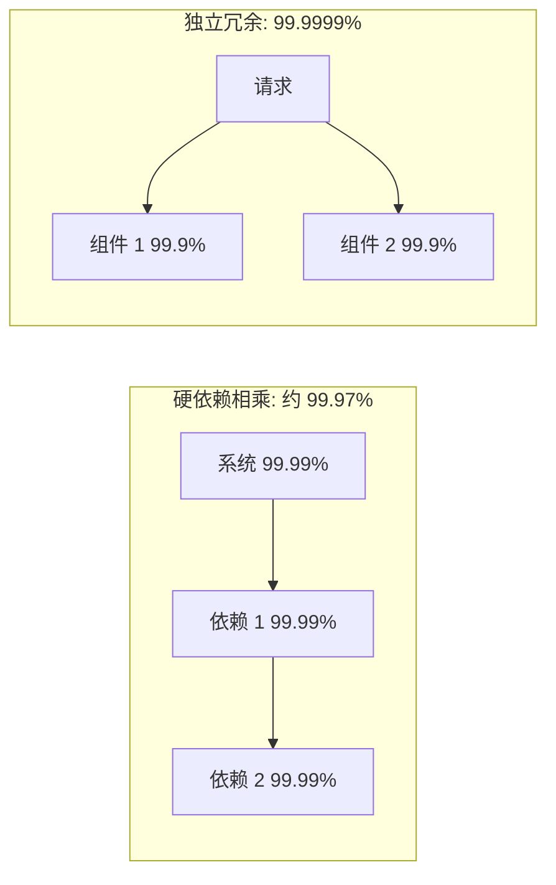

## Definition

High Availability（HA）表示系统在已定义的组件故障和运行条件下，仍能满足可用性目标。它不是“永不失败”，而是通过冗余、故障隔离和恢复把停机控制在预算内。

Availability 通常表示为一段时间（常按月或年）内的正常运行时间百分比。

## Key Terms

| 中文 | English | 含义 |
| --- | --- | --- |
| 高可用 | High Availability（HA） | 在定义的故障条件下仍满足可用性目标 |
| 可用性 | Availability | 一段时间内的正常运行时间百分比 |
| 停机预算 | Downtime Budget | 在可用性目标下允许的停机时间 |
| 硬依赖 | Hard Dependency | 依赖中断会直接导致本系统中断 |
| 冗余 | Redundancy | 用多个独立组件互相补偿 |
| 单点故障 | SPOF（Single Point of Failure） | 一旦故障就导致整体失败的组件 |
| 平均故障间隔 / 平均恢复时间 | MTBF / MTTR | 用于估算可用性 |
| 服务等级目标 | SLO（Service Level Objective） | 给指标设定的目标值 |

## Composing Availability

## Availability Budget

按 365 天计算的理论年度停机预算：

| Availability | Approximate downtime |
| --- | --- |
| 99% | 3 天 15 小时 36 分钟 |
| 99.9% | 8 小时 45 分钟 36 秒 |
| 99.95% | 4 小时 22 分钟 48 秒 |
| 99.99% | 52 分钟 34 秒 |
| 99.999% | 5 分钟 15 秒 |

这些只是数学预算，不代表任何云服务的 SLA。

## Composing Availability

- **硬依赖相乘**：当系统硬依赖其他系统时，整体可用性是各部分可用性的乘积。例如一个设计为 99.99% 的系统，硬依赖两个同样为 99.99% 的独立系统，理论上整体约为 99.99% × 99.99% × 99.99% ≈ 99.97%。
- **冗余相互补偿**：两个独立、冗余、可用性均为 99.9% 的组件，有效可用性为 100% − (0.1% × 0.1%) = 99.9999%。
- 这两个公式都假设组件的故障相互独立。共享同一个可用区、同一次发布或同一个依赖的“冗余”组件不满足这个前提，实际可用性会低于计算值。
- 对没有公布可用性的组件，可以用 MTBF 和 MTTR 估算：可用性约为 MTBF / (MTBF + MTTR)。

## Design Checklist

- 明确服务边界、SLO、延迟和一致性需求。
- 消除关键单点故障。
- 在适当边界使用无状态服务和水平扩展。
- 为数据库设计复制、故障切换、备份和恢复验证。
- 对下游调用设置 timeout、有限 [[Retry|重试]] 和 [[Circuit Breaker]]。
- 使用 [[Graceful Degradation]] 隔离非关键功能。
- 通过负载测试和故障演练验证，而不是只依赖架构图。

## Connections

### Distinguished from
- [[Reliability]]
- [[Scalability]]
- [[Durability]]

### Recovery
- [[Disaster Recovery]]

### Operations
- [[Observability]]

## Sources

- [AWS Well-Architected Reliability Pillar — Availability](https://docs.aws.amazon.com/wellarchitected/latest/reliability-pillar/availability.html)
