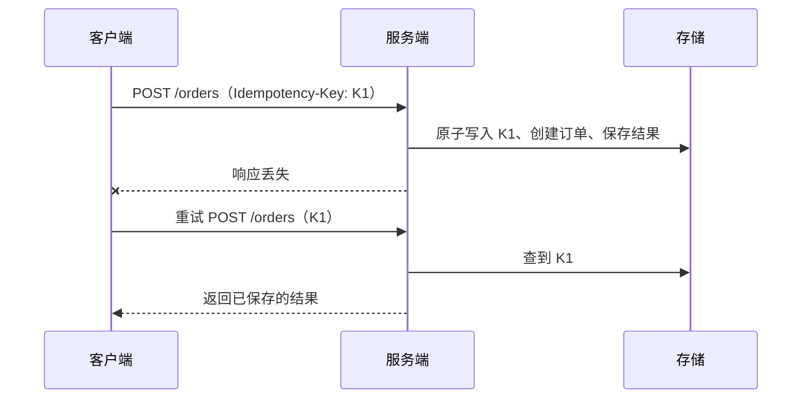

## Definition

Idempotency（幂等性）表示同一个操作重复执行多次，效果与执行一次相同。落到业务上，就是同一个业务操作重复执行时，不会重复产生业务副作用。

## Key Terms

| 中文 | English | 含义 |
| --- | --- | --- |
| 幂等 | Idempotency | 重复执行与执行一次的效果相同 |
| 幂等键 | Idempotency Key | 客户端提供、用于识别重试的唯一标识 |
| 安全方法 | Safe Method | 语义上只读的 HTTP 方法 |
| 重试 | Retry | 重新执行可能因暂时故障而失败的操作 |
| 唯一约束 | Unique Constraint | 用来拦截并发的重复写入 |

## Retry With an Idempotency Key

## HTTP Method Idempotency

[RFC 9110](https://www.rfc-editor.org/rfc/rfc9110.html#name-idempotent-methods) 把请求方法的幂等性定义为：多个相同请求对服务器产生的预期效果，与单个这样的请求相同。

- PUT、DELETE 以及所有 safe 方法（GET、HEAD、OPTIONS、TRACE）是幂等的；POST 不是。
- **幂等不等于安全**：PUT 和 DELETE 会修改状态，但重复执行结果不变。每个 safe 方法都是幂等的，反过来不成立。
- 幂等针对的是“预期效果”。响应可以不同（例如第二次 DELETE 返回 404），服务器也可以每次都记录日志。
- 幂等方法在连接中断时可以自动重试；非幂等方法除非有办法确认请求从未生效或语义实际幂等，否则客户端不应自动重试。

方法层面的幂等只是约定。业务 API 的幂等需要服务端的实际实现。

## API Example: Idempotency Key

客户端为创建订单请求提供唯一 Idempotency Key。服务端需要原子地建立 Key、请求参数与业务结果的关联：

- 第一次请求创建订单并保存结果。
- 相同 Key、相同参数的重试返回原结果。
- 相同 Key、不同参数应拒绝或明确报告冲突。

只做“先查询 Key 是否存在，再写入”仍可能被两个并发请求同时穿透，应使用唯一约束、条件写入或事务。

Stripe API v1 的做法可以作为参考：

- 保存带有该 Key 的首个请求执行后的状态码和响应体，相同 Key 的重试返回已保存的响应，包括 500 错误。
- 比较重试请求的参数与原请求，不一致则报错。
- 只有请求开始执行后才保存结果；参数校验失败或与并发请求冲突时不保存，这类请求可以重试。
- Key 在至少 24 小时之后可能被清除，之后复用同一个 Key 会被当作新请求。
- 所有 POST 请求接受 Key；GET 和 DELETE 本身就是幂等的，不需要 Key。

## Consumer Example

消息消费者可以使用唯一 event ID 或 execution ID 记录已处理事件。Worker 在更新业务状态时，需要让“记录已处理”和“产生业务效果”保持原子一致。

## Gotchas

- Key 要有明确的作用域（例如按租户或用户）和保留期；保留期过短会让迟到的重试被当成新请求。
- 幂等记录的写入与业务效果必须在同一个原子操作里，否则崩溃时可能只完成一半。
- 幂等只保证重复执行不产生额外效果，不保证重复请求拿到完全相同的响应。

## Connections

### Required by
- [[Delivery Semantics]]
- [[Retry]]
- [[Reliable Asynchronous Processing]]

### Enforced with
- [[Atomic Operation]]
- [[Transactional Outbox]]

### Case study
- [[Order Processing Consistency Case Study]]

## Sources

- [RFC 9110 §9.2.2 — Idempotent Methods](https://www.rfc-editor.org/rfc/rfc9110.html#name-idempotent-methods)
- [Stripe API — Idempotent requests](https://docs.stripe.com/api/idempotent_requests)
