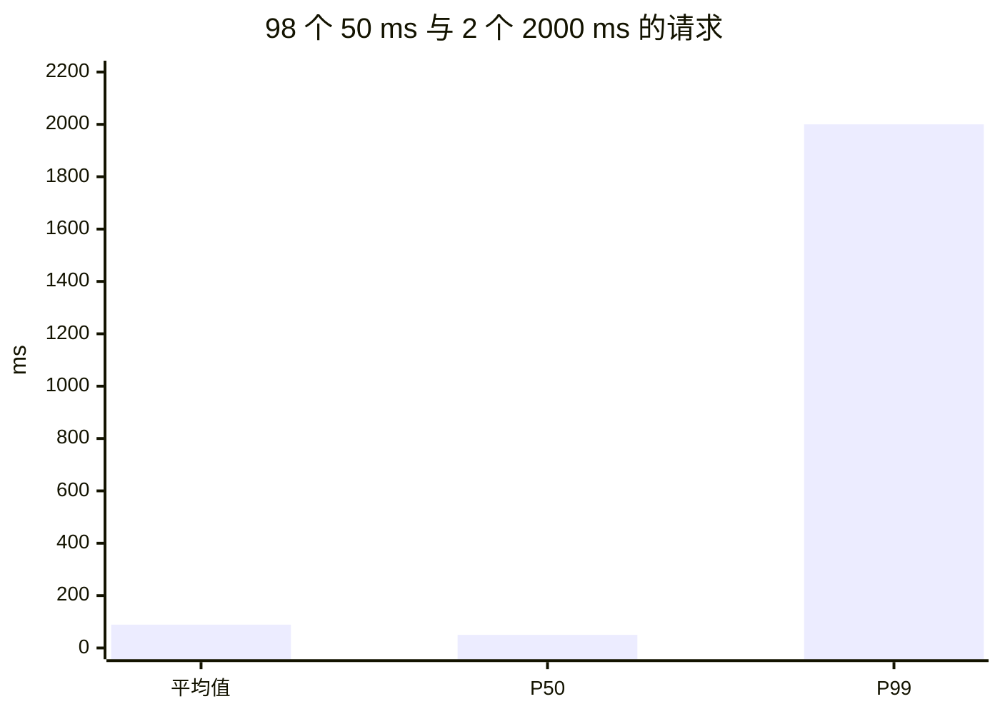

## Definition

Latency Percentile 表示在给定样本集合和时间窗口内，一定比例的请求延迟不高于某个值。

- P50：约 50% 请求在该延迟以内，是中位数体验。
- P95：约 95% 请求在该延迟以内。
- P99：约 99% 请求在该延迟以内。

例如 P99=2 秒表示在相应统计窗口和计算方法下，大约 99% 的请求延迟不超过 2 秒。

## Key Terms

| 中文 | English | 含义 |
| --- | --- | --- |
| 延迟百分位 | Latency Percentile | 一定比例的请求延迟不高于某个值 |
| 中位数 | Median（P50） | 50% 的请求延迟不高于它 |
| 尾延迟 | Tail Latency | 分布尾部少量显著更慢的请求 |
| 统计窗口 | Measurement Window | 计算百分位所用的时间范围 |
| 直方图 | Histogram | 按区间统计延迟分布，百分位据此估算 |
| 平均值 | Mean | 全部延迟的算术平均，会掩盖尾部 |

## Mean Hides the Tail

假设 100 个请求中 98 个耗时 50 ms，2 个耗时 2000 ms：平均值是 89 ms，P50 是 50 ms，P99 是 2000 ms。

## Why Not Only Average

少量非常慢的请求可能只轻微影响平均值，却会显著影响真实用户和依赖多个后端的页面。高百分位能帮助发现 [[Tail Latency|尾部延迟]]。

Google SRE 指出：大多数指标更适合看作分布而不是平均值。大多数请求很快、少数请求慢很多是完全可能的，只看平均值会掩盖尾部延迟及其变化。高分位（如 P99、P99.9）显示一个合理的最坏情况，而 P50 强调典型情况。

## Gotchas

- 必须注明统计窗口、请求范围和区域。
- 监控系统可能使用直方图 bucket 和插值估算百分位。
- 样本太少时 P99 可能只代表一个请求，统计意义有限。
- 不能对已经聚合的百分位再次做简单平均来得到全局百分位。

## Connections

### Signal in
- [[Observability]]

### Measures
- [[Tail Latency]]

## Sources

- [Google SRE — Service Level Objectives](https://sre.google/sre-book/service-level-objectives/)
