## Definition

Linearizability（线性一致性）是最强的单对象一致性模型之一：每个操作看起来都在某一时刻原子生效，并且这些时刻的先后顺序符合真实时间中的先后关系。若操作 A 在操作 B 开始之前已经完成，那么逻辑上 B 必须在 A 之后生效。

## Key Terms

| 中文 | English | 含义 |
| --- | --- | --- |
| 线性一致性 | Linearizability | 每个操作看似在某一刻原子生效，且符合实时顺序 |
| 实时顺序 | Real-time Order | 操作在真实时间中的先后 |
| 调用 / 完成 | Invocation / Completion | 一个操作的开始与结束 |
| 原子 | Atomic | 对外表现为不可分割 |
| 对象 | Object | 被操作的单个数据，如一个 key |

## Example

```mermaid
gantt
    dateFormat X
    axisFormat %s
    title 时间轴上的三个操作
    section Client 1
    write(x=1) :a1, 0, 4
    section Client 2
    read(x) 必须返回 1 或更新的值 :a2, 5, 8
    section Client 3
    read(x) 与写入重叠，可以返回旧值或 1 :a3, 2, 6
```

- 写入完成之后才开始的读取，必须看到这次写入。
- 与写入重叠的读取，可以返回旧值或新值；但一旦有读取返回了新值，之后开始的读取就不能再返回旧值。

## Scope of "Object"

Linearizability 是单对象模型，但“一个对象”的范围因系统而异：可能是 key-value 存储里的单个 key，也可能是一张表或一个数据库里的多个 key，但不会跨越不同的表或数据库。需要跨多个对象的线性一致，应使用 [[Serializability#Strict Serializability|Strict Serializability]]。

## Cost

Linearizability 不能做到 totally 或 sticky available：发生网络分区时，部分或全部节点无法继续处理请求。这正是 [[CAP Theorem]] 里 C 与 A 冲突的来源。

## Gotchas

- Linearizability 约束单个对象的实时顺序；[[Serializability]] 约束多对象事务的总顺序，但不要求实时。两者不能互相替代。
- “读取最新值”不是一个自带含义的说法，要说明是在什么模型下的“最新”。
- 在单个数据库或服务的内部做到线性一致，不等于两个独立系统之间也是线性一致。

## Connections

### Broader concept
- [[Consistency Models]]
- [[Consistency]]

### Theory
- [[CAP Theorem]]

### Combined with transactions
- [[Serializability#Strict Serializability|Strict Serializability]]

## Sources

- [Jepsen — Linearizability](https://jepsen.io/consistency/models/linearizable)
- [Jepsen — Consistency Models](https://jepsen.io/consistency/models)
