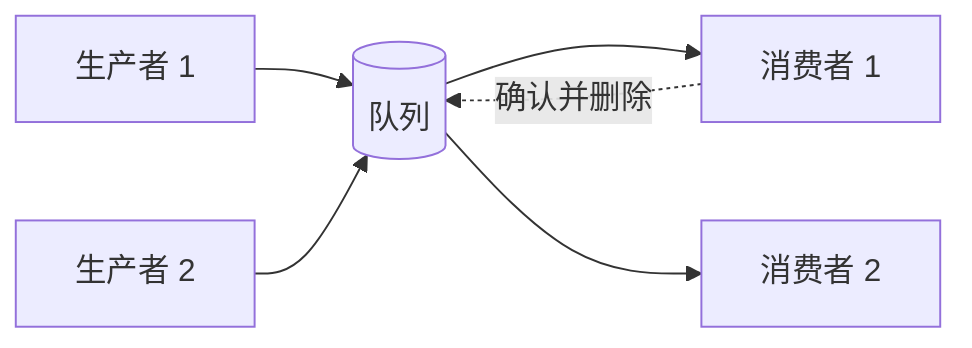

## Definition

Message Queue 在生产者和消费者之间持久或暂时保存消息，让请求接收与实际处理解耦。

## Key Terms

| 中文 | English | 含义 |
| --- | --- | --- |
| 消息队列 | Message Queue | 在生产者和消费者之间保存消息 |
| 生产者 / 消费者 | Producer / Consumer | 发送消息的一方 / 接收并处理消息的一方 |
| 背压 | Backpressure | 积压带来的“消费跟不上生产”的信号 |
| 确认 | Acknowledgment | 处理成功后告知队列删除消息 |
| 重新投递 | Redelivery | 未确认的消息重新变得可见并再次投递 |

## Producers, Queue, Consumers

## What It Provides

- 吸收短时间流量峰值。
- 让生产者不必等待后台任务完成。
- 隔离消费者的暂时故障。
- 独立控制生产与消费速率。

## Consume, Acknowledge, Redeliver

消费者取走消息后，队列并不会立刻认为它已处理完成：

1. 消费者收到消息，队列在处理期间锁定该消息，避免其他消费者同时处理它。
2. 处理成功后，消费者确认（或删除）消息。
3. 处理失败或消费者崩溃而没有确认时，消息会重新变得可见并被再次投递。

多个生产者可以同时发送，多个消费者可以同时接收。因为存在重新投递，消费者必须能安全处理重复消息，见 [[Delivery Semantics]]。

## What It Does Not Guarantee Automatically

- 业务效果只发生一次。
- 所有消息严格有序。
- 消费者永远不会收到重复消息。
- 下游系统不会被过高的 Worker 并发压垮。

队列积压是一种 Backpressure 信号。扩容消费者之前，应确认数据库和外部 API 的容量。

## Connections

### Reliability mechanisms
- [[Delivery Semantics]]
- [[Idempotency]]
- [[Retry]]
- [[Dead Letter Queue]]

### Implementation
- [[Amazon SQS]]

### Pattern
- [[Reliable Asynchronous Processing]]

## Sources

- [Amazon SQS — What is Amazon SQS](https://docs.aws.amazon.com/AWSSimpleQueueService/latest/SQSDeveloperGuide/welcome.html)
