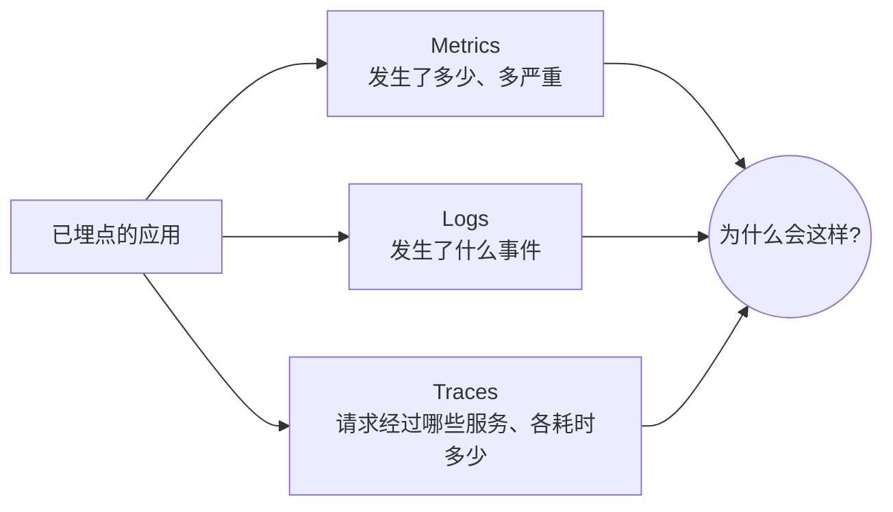

## Definition

Observability（可观测性）是不需要了解系统内部实现，就能通过它输出的信号向它提问、理解其内部状态和故障原因的能力。它特别适用于排查没有预料到的新问题（“unknown unknowns”），回答“为什么会这样”。

前提是应用被充分埋点（instrumented）：应用代码输出 traces、metrics、logs，且排查问题时不必临时再加埋点。

## Key Terms

| 中文 | English | 含义 |
| --- | --- | --- |
| 可观测性 | Observability | 通过系统输出理解其内部状态和故障原因 |
| 指标 | Metrics | 一段时间内聚合的数值 |
| 日志 | Logs | 带时间戳的离散事件 |
| 链路追踪 | Traces | 请求跨服务传播及各阶段耗时 |
| 埋点 | Instrumentation | 让应用输出这些信号的代码 |
| 跨度 | Span | 追踪中的一次操作执行 |
| 追踪上下文 | Trace Context | 跨服务传递的追踪标识，如 `traceparent` |
| 服务等级指标 / 目标 | SLI / SLO | 对服务行为的度量 / 给它设定的目标 |

## Three Signals



## Signals

- **Metrics**：一段时间内聚合的数值，例如错误率、CPU 使用率、请求速率、队列积压和延迟。
- **Logs**：带时间戳的离散消息，不一定属于某个特定请求。要带上上下文和 request ID，才能与具体请求关联。
- **Traces**：展示请求跨服务传播和每个阶段耗时，由 spans 组成。

仅拥有日志不等于具备完整的 Distributed Tracing。跨服务追踪需要传播 Trace Context，并在采集和查询系统中关联。

## Trace Context

W3C Trace Context 规范定义了 `traceparent` HTTP 头，用于在服务之间传递追踪信息：

```text
traceparent: 00-0af7651916cd43dd8448eb211c80319c-b7ad6b7169203331-01
```

格式为 `version-trace-id-parent-id-trace-flags`：

- `version`：当前为 `00`。
- `trace-id` 标识整条分布式追踪（32 位十六进制）。
- `parent-id`（16 位十六进制）是调用方眼中本次请求的 ID，在一些追踪系统里叫 span-id。
- `trace-flags`：8 位标志。
- 全零的 `trace-id` 或 `parent-id` 无效，接收方必须忽略该头。

## From Signals to Reliability: SLI and SLO

- **SLI**（Service Level Indicator）：对服务行为的度量，好的 SLI 从用户视角衡量，例如页面加载速度。
- **SLO**（Service Level Objective）：给 SLI 设定的目标值或范围，例如 99% 的请求在 100 ms 内完成。

## Useful Measurements

- Error Rate
- Throughput
- [[Latency Percentiles]]
- Queue backlog 与 oldest message age
- Throttling、dependency failures 和 DLQ messages
- 业务成功率，而不只是 CPU 和 Memory

## Connections

### Measures
- [[Tail Latency]]
- [[Scalability]]
- [[Reliability]]

### Used by
- [[High Availability]]
- [[Reliable Asynchronous Processing]]

### Implementations
- [[Amazon SQS]]
- [[AWS Lambda]]

## Sources

- [OpenTelemetry — Observability primer](https://opentelemetry.io/docs/concepts/observability-primer/)
- [W3C — Trace Context](https://www.w3.org/TR/trace-context/)
- [Google SRE — Service Level Objectives](https://sre.google/sre-book/service-level-objectives/)
