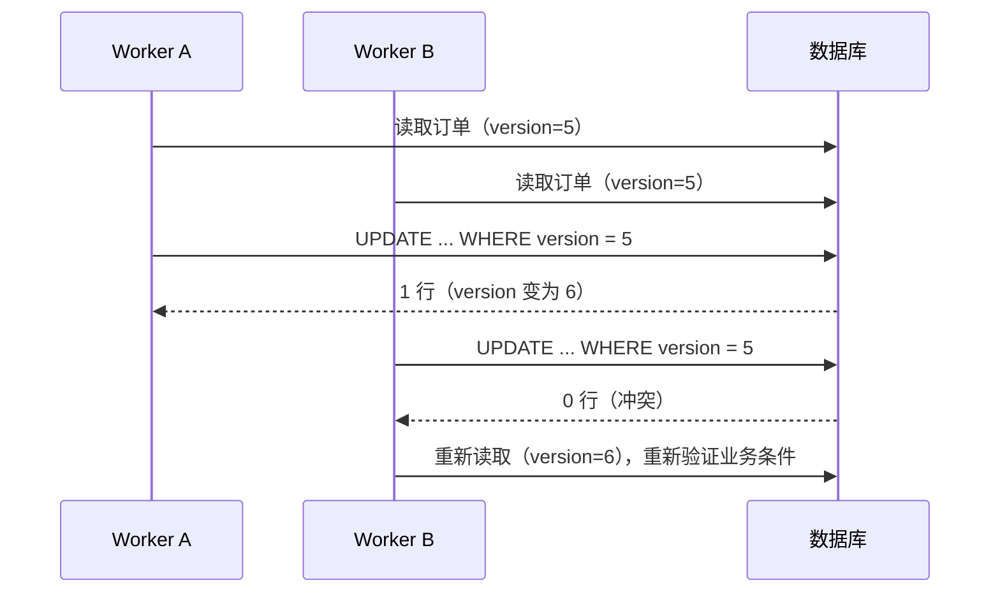

## Definition

Optimistic Locking 假设冲突相对少见，不预先长期持有锁，而是在提交时检查读取后的数据是否被其他操作修改。

## Key Terms

| 中文 | English | 含义 |
| --- | --- | --- |
| 乐观锁 | Optimistic Locking | 提交时检查数据是否被他人修改 |
| 悲观锁 | Pessimistic Locking | 提前加锁，阻止冲突 |
| 版本号 | Version Number | 每次更新递增，用来检测冲突 |
| 条件写入 | Conditional Write | 只在条件成立时写入 |
| 乐观并发控制 | OCC（Optimistic Concurrency Control） | 乐观锁的一般说法 |
| 丢失更新 | Lost Update | 后提交的写入覆盖先前结果 |

## Version Conflict



## Version Check

```sql
UPDATE orders
SET status = 'CANCELED', version = version + 1
WHERE order_id = 'ORD-1001'
  AND version = 5;
```

读取订单时拿到 version=5。如果另一个 Worker 已经把 version 更新为 6，本次操作会更新 0 行。调用者需要重新读取状态，再决定重试、拒绝或执行其他业务动作。

## DynamoDB Version

DynamoDB 用条件表达式实现同样的检查：

```python
table.update_item(
    Key={"ItemId": "Bananas"},
    UpdateExpression="SET QuantityLeft = QuantityLeft - :n, Version = Version + :one",
    ConditionExpression="Version = :expected",
    ExpressionAttributeValues={":n": 1, ":one": 1, ":expected": 5},
)
```

版本不匹配时，DynamoDB 返回 `ConditionalCheckFailedException`。AWS 文档指出，这种版本号乐观锁在跨 Region 写入时不能按预期工作，因为另一个 Region 的并发写入可能在没有版本检查的情况下覆盖本次写入。

## Optimistic vs Pessimistic

| | Optimistic | Pessimistic |
| --- | --- | --- |
| 做法 | 提交时检测冲突 | 提前加锁，阻止冲突 |
| 适合 | 冲突少、重试成本低 | 冲突频繁、重试成本高 |
| 代价 | 高冲突下大量重试 | 持锁等待、死锁风险 |

AWS 架构博客的模拟显示，OCC 总能保证有进展，但在高竞争下表现很差：N 个客户端同时竞争时，系统总工作量按 N² 增长。重试时需要 [[Exponential Backoff and Jitter|退避和 jitter]]。

## Gotchas

- 它可以防止 Lost Update，但不自动保护跨多行不变量。
- 冲突频繁时，反复重试可能降低性能。
- 重试前必须重新验证业务条件，不能只机械重放旧写入。

## Connections

### Technique for
- [[Concurrency Control]]

### Related concepts
- [[Atomic Operation]]
- [[Transaction Isolation]]
- [[Snapshot Isolation]]
- [[Retry]]
- [[Exponential Backoff and Jitter]]

## Sources

- [Amazon DynamoDB — Optimistic locking with version number](https://docs.aws.amazon.com/amazondynamodb/latest/developerguide/BestPractices_OptimisticLocking.html)
- [AWS Architecture Blog — Exponential Backoff and Jitter](https://aws.amazon.com/blogs/architecture/exponential-backoff-and-jitter/)
