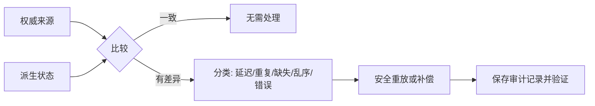

## Definition

Reconciliation（对账）将系统当前状态与权威事实来源比较，发现遗漏、重复和不一致，并按明确流程修复。

## Key Terms

| 中文 | English | 含义 |
| --- | --- | --- |
| 对账 | Reconciliation | 把当前状态与权威来源比较，发现并修复差异 |
| 权威来源 | Authoritative Source | 以其内容为准的数据 |
| 派生状态 | Derived State | 由权威来源生成的状态，如报表、持仓 |
| 补偿 | Compensation | 用额外操作修正已发生的错误 |
| 审计记录 | Audit Trail | 记录修复过程，便于追溯 |
| 重放 | Replay | 重新处理事件以补齐缺失 |

## Reconciliation Workflow

## Why It Is Needed

重试、幂等和事务可以显著降低错误，但跨服务、跨系统和外部执行仍可能留下异常。金融、支付和库存等不能容忍静默错误的系统，尤其需要独立的对账作为最后一道正确性保障。

## Workflow

1. 选择权威来源，例如支付记录或资金账本。
2. 比较派生状态，例如订单状态或报表。
3. 分类差异：延迟、重复、缺失、乱序或数据错误。
4. 安全重放或执行补偿操作。
5. 保存审计记录并验证结果。

## Example

| 订单 ID | 事实来源（支付记录） | 派生状态（订单已付金额） | 差异类型 | 处理 |
| --- | --- | --- | --- | --- |
| A-1 | 已支付 100 元 | 100 元 | 无 | 无 |
| A-2 | 已支付 50 元 | 0 元 | 缺失 | 重放支付事件（需幂等） |
| A-3 | 已支付 30 元 | 60 元 | 重复 | 按事件 ID 去重并补偿 |
| A-4 | 已支付 20 元 | 0 元，消息仍在队列中 | 延迟 | 等待处理，超时后告警 |

注意重放必须是安全的，否则对账本身会制造新的重复，见 [[Idempotency]]。

## Connections

### Protects
- [[Consistency]]
- [[Reliability]]
- [[Durability]]

### Used after
- [[Dead Letter Queue]]
- [[Disaster Recovery]]

### Case study
- [[Order Processing Consistency Case Study]]
