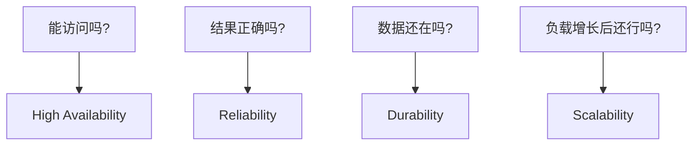

## Definition

Reliability 表示系统在规定时间和条件下持续正确完成预期功能的能力。

一个服务可能一直返回 HTTP 200，因此看起来可用，但如果重复扣款、丢失订单或返回错误结果，它并不可靠。OpenTelemetry 文档用同样的思路说明：系统可以 100% 在线，但用户点击“加入购物车”却加错了商品，它依然不可靠。可靠性回答的问题是：“服务是否在做用户期望它做的事？”

## Key Terms

| 中文 | English | 含义 |
| --- | --- | --- |
| 可靠性 | Reliability | 持续正确完成预期功能的能力 |
| 可用性 | Availability | 系统能否被访问 |
| 正确性 | Correctness | 结果是否符合业务不变量 |
| 服务等级指标 | SLI（Service Level Indicator） | 从用户视角对服务行为的度量 |
| 服务等级目标 | SLO（Service Level Objective） | 给 SLI 设定的目标 |

## Four Questions, Four Properties

## Dimensions

- 正确性：是否维护 [[Data Invariant|业务不变量]]。
- 故障恢复：暂时失败后是否能恢复。
- 重复安全：重试是否造成额外副作用。
- 可检测性：错误是否能被 [[Observability|观测]]。
- 可验证性：是否通过测试和 [[Reconciliation|对账]]确认结果。

## Measuring It

可靠性要通过 SLI 和 SLO 变成可沟通、可检验的目标：SLI 是从用户视角对服务行为的度量，SLO 是给 SLI 设定的目标。常见 SLI 包括请求延迟、错误率和吞吐量，见 [[Observability]]。

## Connections

### Distinguished from
- [[High Availability]]
- [[Scalability]]
- [[Durability]]

### Supported by
- [[Idempotency]]
- [[Consistency]]
- [[Retry]]

## Sources

- [OpenTelemetry — Observability primer: Reliability and metrics](https://opentelemetry.io/docs/concepts/observability-primer/)
- [Google SRE — Service Level Objectives](https://sre.google/sre-book/service-level-objectives/)
