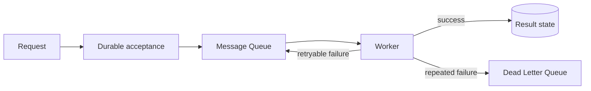

## Purpose

Reliable Asynchronous Processing 是一个组合模式：请求被可靠接收后，通过队列交给独立 Worker 处理，让 API 延迟、后台执行和故障恢复彼此解耦。

## Required Building Blocks

- [[Message Queue]]：缓冲任务和提供 Backpressure。
- [[Idempotency]]：处理重复请求和重复投递。
- [[Delivery Semantics]]：明确可能丢失或重复的边界。
- [[Retry]]：恢复暂时故障。
- [[Dead Letter Queue]]：隔离持续失败消息。
- [[Transactional Outbox]]：避免数据库与消息发布之间的 Dual Write。
- [[Observability]]：监控积压、失败、延迟和恢复。

## Failure Questions

- 发送消息超时时，是否已经成功入队？
- Worker 更新数据库后、确认消息前崩溃会怎样？
- Worker 扩容是否会压垮数据库或外部 API？
- 消息乱序、重复或进入 DLQ 后如何恢复？

## Connections

### Implementation
- [[Amazon SQS]]
- [[AWS Lambda]]

### Case study
- [[Order Processing Consistency Case Study]]

