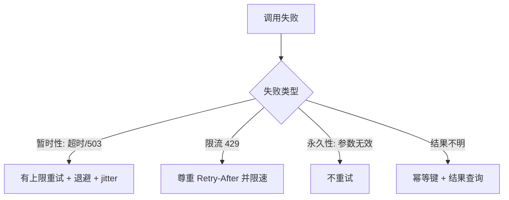

## Definition

Retry 用于重新执行可能因暂时故障而失败的操作。

## Key Terms

| 中文 | English | 含义 |
| --- | --- | --- |
| 重试 | Retry | 重新执行可能因暂时故障而失败的操作 |
| 暂时性故障 | Transient Failure | 稍后可能自行恢复的故障 |
| 限流 | Rate Limiting | 服务端限制请求速率，常返回 429 |
| 超时 | Timeout | 调用最多等待的时间 |
| 重试放大 | Retry Amplification | 多层独立重试使下游负载成倍增加 |
| 令牌桶 | Token Bucket | 用令牌限制本地重试速率 |
| 结果不明 | Ambiguous Outcome | 请求可能已成功，但响应丢失 |

## Decide by Failure Type

## Classify the Failure First

| 失败类型 | 示例 | 处理方向 |
| --- | --- | --- |
| Transient | 网络超时、临时 503 | 有上限重试 |
| Rate limiting | 429 | 尊重 Retry-After 并限速 |
| Permanent | 无效参数、非法状态转换 | 不盲目重试 |
| Ambiguous outcome | 请求可能成功但响应丢失 | 依赖幂等键和结果查询 |

## Rules

- 设置超时：任何远程调用都应有 connection timeout 和 request timeout，否则失败请求会一直占用资源。
- 设置最大次数或总时间预算。
- 使用 [[Exponential Backoff and Jitter]]。
- 只在安全操作或具备 [[Idempotency|幂等性]] 时重试：有副作用的 API 除非提供幂等，否则重试不安全；超时或失败不代表副作用没有发生。
- 避免多个调用层同时独立重试，造成重试放大。
- 持续失败时进入明确的隔离和人工处理流程，而不是无限循环。

## Retry Amplification

AWS Builders' Library 给出的例子：一个调用链有 5 层，每层最多尝试 3 次。数据库开始失败时，每一层都独立重试，各层的重试相乘，数据库承受的负载会增加到 3^5 = 243 倍，几乎不可能恢复。对低成本操作，AWS 的做法是只在调用栈的一个点重试。

即使只有一层重试，出错时流量仍然上升。AWS 的做法是用 token bucket 在本地限制重试：令牌用完后，只以固定速率重试。AWS SDK 自 2016 年起内置了这种行为。

## Connections

### Safety
- [[Idempotency]]
- [[Delivery Semantics]]

### Failure isolation
- [[Dead Letter Queue]]
- [[Circuit Breaker]]

### Technique
- [[Exponential Backoff and Jitter]]

## Sources

- [AWS Builders' Library — Timeouts, retries, and backoff with jitter](https://aws.amazon.com/builders-library/timeouts-retries-and-backoff-with-jitter/)
- [Azure Architecture Center — Retry pattern](https://learn.microsoft.com/en-us/azure/architecture/patterns/retry)
