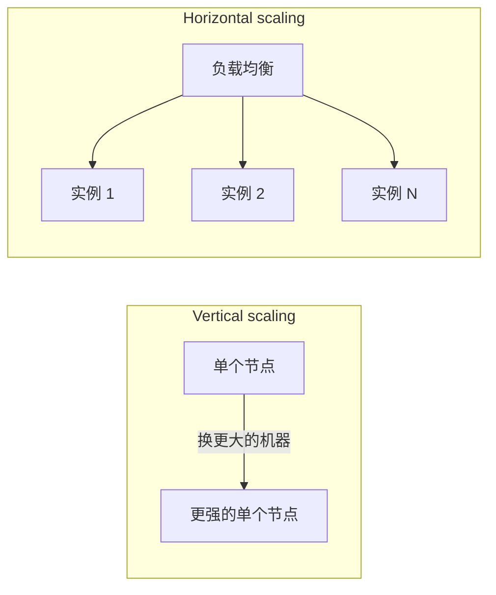

## Definition

Scalability 描述系统在负载增长时，通过增加资源、改变架构或改善效率继续满足性能目标的能力。

## Key Terms

| 中文 | English | 含义 |
| --- | --- | --- |
| 可扩展性 | Scalability | 负载增长时继续满足性能目标的能力 |
| 垂直扩展 | Vertical Scaling | 提升单个节点资源 |
| 水平扩展 | Horizontal Scaling | 增加实例或 Worker |
| 弹性 | Elasticity | 按负载动态增减资源 |
| 背压 | Backpressure | 消费者满载时控制生产速率 |
| 瓶颈 | Bottleneck | 限制整体吞吐的环节 |

## Vertical vs Horizontal

## Dimensions

- **Vertical scaling**：提升单个节点资源。
- **Horizontal scaling**：增加服务实例或 Worker。
- **Elasticity**：按负载动态增减资源。
- **Backpressure**：当消费者达到容量时，控制生产速率或缓冲请求。

## Scaling and Availability

水平扩展也会影响可用性：AWS Well-Architected 建议用多个较小的资源替换一个大资源，把请求分散到不共享同一故障点的资源上，以降低单点故障对整体的影响。反过来，没有这样设计的高吞吐系统仍可能存在单点故障。资源饱和是常见的故障原因，因此需要监控需求和利用率，并自动增减资源，而不是靠猜测容量。

## Gotchas

- Highly scalable 不等于必须使用 [[Kubernetes]]。
- API 扩容不代表数据库、外部 API 和热点分区也能承受相同增长。
- 无限增加 Worker 可能把瓶颈转移到下游。
- 吞吐量很高的系统仍可能存在单点故障，因此 Scalability 不等于 [[High Availability]]。

## Connections

### Compared in
- [[AWS Compute Options]]

### Measured through
- [[Observability]]
- [[Latency Percentiles]]

### Related pattern
- [[Message Queue]]

## Sources

- [AWS Well-Architected Reliability Pillar — Design principles](https://docs.aws.amazon.com/wellarchitected/latest/reliability-pillar/design-principles.html)
