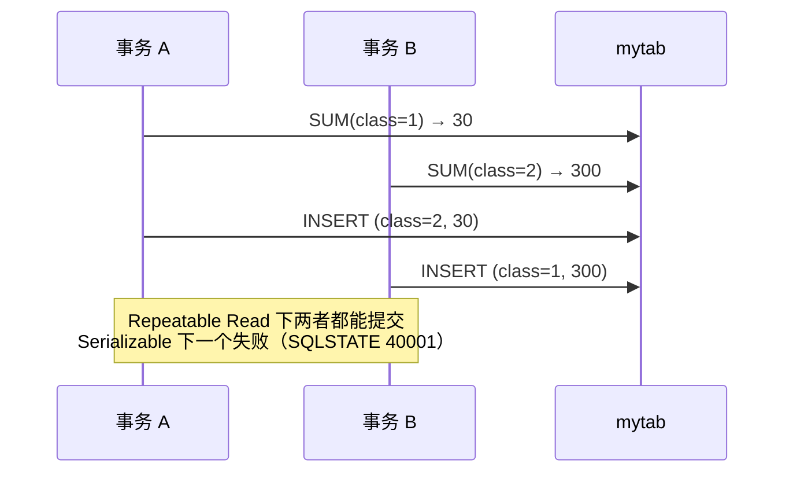

## Definition

Serializability（可串行化）表示：并发执行的一组事务，其结果看起来与它们按某个总顺序、一个接一个地执行完全相同。每个事务内部的子操作不会与其他事务的子操作交错可见。

它是多对象、事务级的模型，约束作用于整个系统，包括基于条件的查询，例如“所有满足某条件的行”。

## Key Terms

| 中文 | English | 含义 |
| --- | --- | --- |
| 可串行化 | Serializability | 并发事务的结果等价于某个串行顺序 |
| 严格可串行化 | Strict Serializability | 可串行化，且顺序符合实时先后 |
| 谓词 | Predicate | 条件，如“所有满足某条件的行” |
| 写偏斜 | Write Skew | 读重叠数据、写不相交对象，破坏跨对象约束 |
| 串行化异常 | Serialization Anomaly | 结果与任何串行顺序都不一致 |
| 可串行化快照隔离 | SSI（Serializable Snapshot Isolation） | 在快照隔离上检测依赖，PostgreSQL 的 Serializable 用它实现 |

## Write Skew Under Repeatable Read

## What It Does Not Promise

- **没有实时要求**：进程 A 完成写入之后，进程 B 开始的读取不一定能看到它。
- **没有每个进程的顺序要求**：同一个进程的后一个事务，可能看不到它自己前一个事务的写入。
- **允许不直观的顺序**：Jepsen 指出，一个可串行化的数据库理论上可以把所有读取排在时间 0，始终返回空状态。实际实现通常不会这样做，但模型本身并不禁止。

## Write Skew Example

PostgreSQL 文档中的例子：表 `mytab` 里 class=1 的行值为 10 和 20，class=2 的行值为 100 和 200。

- 事务 A 计算 class=1 的总和（30），并把结果作为新行插入 class=2。
- 并发的事务 B 计算 class=2 的总和（300），并把结果作为新行插入 class=1。

如果两者都在 Repeatable Read（即 [[Snapshot Isolation]]）下运行，都能提交；但不存在任何串行顺序能得到这个结果，因为无论 A 在前还是 B 在前，另一个事务算出的总和都会不同。在 Serializable 下，PostgreSQL 会让其中一个事务提交，另一个失败，并报告 `could not serialize access due to read/write dependencies among transactions`。

## Strict Serializability

Strict Serializability（也叫 Strong Serializability）在可串行化的基础上增加实时约束：如果事务 A 在事务 B 开始之前完成，则串行顺序中 A 必须在 B 之前。

- 它蕴含 Serializable 和 [[Linearizability]]。
- 可以理解为：把整个数据库当作一个线性一致的对象。
- 同样不能做到 totally 或 sticky available。

## In Practice

PostgreSQL 的 Serializable 基于 Serializable Snapshot Isolation（SSI），在 Snapshot Isolation 之上监控读写依赖，发现可能导致异常的组合时让事务失败。使用时必须准备好整体重试（SQLSTATE `40001`），见 [[Transaction Isolation]]。

## Connections

### Broader concept
- [[Consistency Models]]

### Weaker model
- [[Snapshot Isolation]]
- [[Transaction Isolation]]

### Combines with
- [[Linearizability]]

### Used to enforce
- [[Data Invariant]]
- [[Concurrency Control]]

## Sources

- [Jepsen — Serializability](https://jepsen.io/consistency/models/serializable)
- [Jepsen — Strong Serializability](https://jepsen.io/consistency/models/strict-serializable)
- [PostgreSQL — Transaction Isolation: Serializable](https://www.postgresql.org/docs/current/transaction-iso.html#XACT-SERIALIZABLE)
