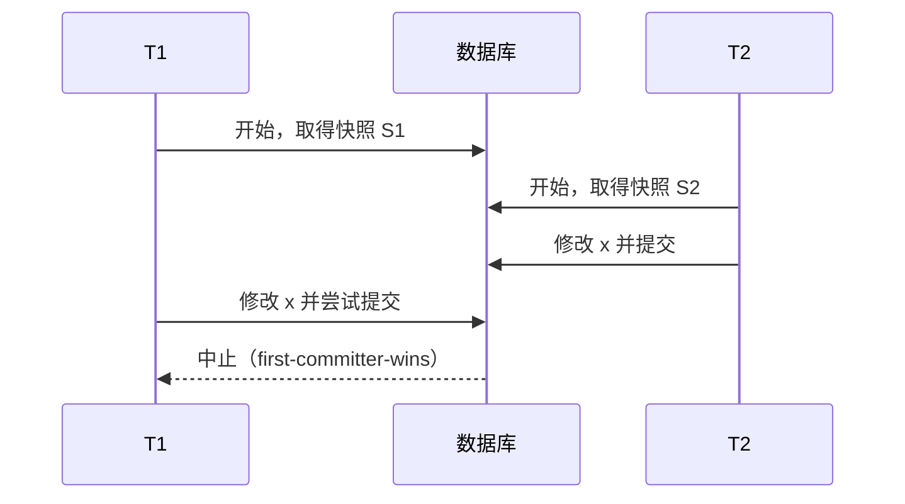

## Definition

Snapshot Isolation（SI）让每个事务看起来都在一份独立、一致的数据库快照上运行。事务的修改在提交前只对自己可见，提交时所有修改对之后开始的事务原子地可见。

如果事务 T1 修改了对象 x，而另一个事务 T2 在 T1 的快照开始之后、T1 提交之前，已经提交了对 x 的写入，则 T1 必须中止。这条规则叫 first-committer-wins，可以防止 Lost Update。

## Key Terms

| 中文 | English | 含义 |
| --- | --- | --- |
| 快照隔离 | Snapshot Isolation（SI） | 每个事务在独立一致的快照上运行 |
| 快照 | Snapshot | 事务开始时数据库已提交数据的视图 |
| 先提交者获胜 | First-Committer-Wins | 写同一对象时先提交的获胜，后者中止 |
| 写偏斜 | Write Skew | 并发事务写不相交对象，破坏跨对象约束 |
| 丢失更新 | Lost Update | 后提交的写入覆盖先前结果 |
| 只读事务异常 | Read-only Transaction Anomaly | 只读事务看到不一致状态 |

## First-Committer-Wins

## What It Allows

SI 只强制部分顺序，不要求所有事务按一个总顺序执行，因此允许：

- **Write skew**：两个事务读取重叠的数据，各自修改不相交的对象，都提交成功，组合结果却破坏了跨对象约束。
- **Read-only transaction anomaly**：涉及部分不相交写集的只读事务看到不一致的状态。

写入同一对象的冲突会被 first-committer-wins 拦住，但写入不同对象的冲突不会。

## Example

PostgreSQL 文档说明：在 Repeatable Read 下，一个只读事务可能看到“批次已完成”的控制记录，却看不到属于该批次的某条明细记录，因为它读到的是控制记录的较早版本。文档还指出，在这个级别用事务来强制业务规则，若不小心使用显式锁，往往不能正确工作。

另一个完整的 write skew 例子见 [[Serializability#Write Skew Example|Serializability]]。

## In PostgreSQL

PostgreSQL 的 Repeatable Read 就是用 Snapshot Isolation 实现的，比 SQL 标准对该级别的最低要求更强（不会出现 phantom read）。有些系统把 Repeatable Read 和 Snapshot Isolation 当作行为不同的两个级别，所以不能只看名字判断保证。

使用时，更新事务要准备在 `could not serialize access due to concurrent update` 时整体重试。

## Gotchas

- SI 没有实时约束，进程 A 完成写入后，B 的读取不一定能看到。
- 文献对 SI 的严格程度定义不一，Jepsen 采用较宽松的“generalized”定义：这时 SI 严格弱于 [[Serializability]]。
- SI 不能做到 totally available，分区时部分节点可能无法继续。

## Connections

### Broader concept
- [[Consistency Models]]
- [[Transaction Isolation]]

### Stronger model
- [[Serializability]]

### Problem it leaves open
- [[Data Invariant]]
- [[Concurrency Control]]

## Sources

- [Jepsen — Snapshot Isolation](https://jepsen.io/consistency/models/snapshot-isolation)
- [PostgreSQL — Transaction Isolation: Repeatable Read](https://www.postgresql.org/docs/current/transaction-iso.html#XACT-REPEATABLE-READ)
