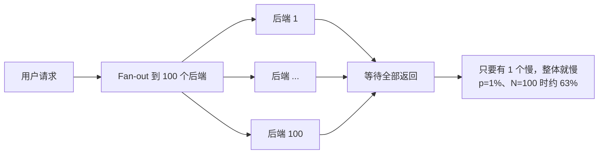

## Definition

Tail Latency 指延迟分布尾部少量、但显著慢于典型请求的情况。

## Key Terms

| 中文 | English | 含义 |
| --- | --- | --- |
| 尾延迟 | Tail Latency | 延迟分布尾部少量显著更慢的请求 |
| 扇出 | Fan-out | 一个请求同时依赖多个后端 |
| 高分位 | High Percentile | 如 P99、P99.9，反映合理的最坏情况 |
| 容忍尾延迟 | Tail-tolerant | 用不可预测的部分构建出可预测响应的整体 |
| 排队 | Queueing | 高负载下等待处理，放大尾延迟 |

## Fan-out Amplifies the Tail



## Why It Matters

- 在高请求量下，1% 仍可能代表大量用户。
- 一个前端请求若依赖多个后端，遇到至少一个慢调用的概率会增加。
- 排队、热点、重试和下游抖动会在高负载下放大尾延迟。

## Fan-out Math

假设每个后端调用有概率 p 属于“慢请求”，一个用户请求需要同时等待 N 个后端，那么它遇到至少一个慢调用的概率是：

```text
1 − (1 − p)^N
```

p = 1%、N = 100 时，结果约为 1 − 0.99^100 ≈ 63%。也就是说，单个后端只有 1% 的慢请求，整个请求却有约 63% 会受影响。Dean 和 Barroso 在 *The Tail at Scale* 中用这个观点说明：在规模较小的系统里无关紧要的临时高延迟事件，在大规模下可能主导整体性能。

该论文提出的方向是构建“容忍尾延迟”（tail-tolerant）的系统：用不可预测的部分构建出可预测响应的整体，并且尽量利用已部署的容错资源，在不增加长尾的前提下提高利用率。

## Investigation

- 使用 [[Latency Percentiles]] 而不是只看平均值。
- 用 traces 找到耗时阶段。
- 将延迟与队列深度、GC、数据库连接、throttling 和下游错误关联。
- 确认统计窗口内是否有足够样本。

## Connections

### Measured by
- [[Latency Percentiles]]

### Diagnosed through
- [[Observability]]

### Related properties
- [[Scalability]]
- [[Reliability]]

## Sources

- [Dean & Barroso — The Tail at Scale](https://research.google/pubs/pub40801/)
- [Google SRE — Service Level Objectives](https://sre.google/sre-book/service-level-objectives/)
