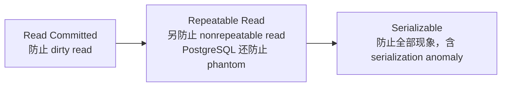

## Definition

Transaction Isolation 描述并发事务之间能够观察和影响彼此到什么程度。

## Key Terms

| 中文 | English | 含义 |
| --- | --- | --- |
| 事务隔离 | Transaction Isolation | 并发事务之间互相可见的程度 |
| 脏读 | Dirty Read | 读到未提交事务写入的数据 |
| 不可重复读 | Nonrepeatable Read | 重读同一数据发现已被其他事务修改 |
| 幻读 | Phantom Read | 重读同一条件查询，满足条件的行集合变了 |
| 串行化异常 | Serialization Anomaly | 结果与任何串行顺序都不一致 |
| 读已提交 | Read Committed | 只读已提交数据，每条语句一个快照 |
| 可重复读 | Repeatable Read | 整个事务一个快照 |
| 可串行化 | Serializable | 等价于某个串行顺序 |

## Isolation Levels, Stronger to the Right

## Important Distinctions

- **Atomicity**：单个事务是否全部成功或全部失败。
- **Isolation**：并发事务之间能看到什么中间状态。
- **Serializability**：并发执行结果是否等价于某种串行顺序。

一个事务内部完全原子，不代表多个并发事务组合起来一定满足所有业务约束。

## Phenomena

隔离级别通过“不允许出现哪些现象”来定义：

| 现象 | 含义 |
| --- | --- |
| Dirty read | 事务读取了并发的、尚未提交的事务写入的数据 |
| Nonrepeatable read | 事务重新读取之前读过的数据，发现它已被另一个已提交的事务修改 |
| Phantom read | 事务重新执行一个按条件查询的语句，发现满足条件的行集合因另一个已提交的事务而变化 |
| Serialization anomaly | 一组成功提交的事务，其结果与它们任何一种串行执行顺序都不一致 |

Write skew 是 serialization anomaly 的一种典型形式，见 [[Snapshot Isolation]]。

## Standard Levels and PostgreSQL

| 级别 | Dirty read | Nonrepeatable read | Phantom read | Serialization anomaly |
| --- | --- | --- | --- | --- |
| Read uncommitted | 标准允许，PostgreSQL 不会出现 | 可能 | 可能 | 可能 |
| Read committed | 不可能 | 可能 | 可能 | 可能 |
| Repeatable read | 不可能 | 不可能 | 标准允许，PostgreSQL 不会出现 | 可能 |
| Serializable | 不可能 | 不可能 | 不可能 | 不可能 |

PostgreSQL 的具体行为：

- 实际只实现三种级别，Read Uncommitted 的行为等同于 Read Committed。默认级别是 Read Committed。
- **Read Committed**：每条语句看到的是该语句开始时的快照，同一事务里的两次 SELECT 可能看到不同数据。
- **Repeatable Read**：用 [[Snapshot Isolation]] 实现，整个事务看到事务开始时的快照。
- **Serializable**：在 Repeatable Read 基础上增加对读写依赖的监控（Serializable Snapshot Isolation），见 [[Serializability]]。

标准里的级别名称不等于保证本身。有的系统把 Repeatable Read 与 Snapshot Isolation 做成行为不同的两个级别。

## Retry Is Part of the Contract

在 PostgreSQL 的 Repeatable Read 和 Serializable 下，并发冲突会让事务失败，应用必须能从头重试整个事务：

- Repeatable Read：更新一行时，如果该行在事务开始之后被其他事务提交修改，报错 `could not serialize access due to concurrent update`。
- Serializable：检测到可能导致异常的读写依赖时失败，SQLSTATE 为 `40001`。

重试时事务会看到已提交的变化，因此不再有逻辑冲突。只读事务不会出现这类冲突。

## Selection

应根据 [[Data Invariant|业务不变量]] 选择隔离方式，而不是默认所有操作都使用最强隔离。单行条件更新（见 [[Atomic Operation]]）在默认的 Read Committed 下可能已经足够；跨记录约束则可能需要 Serializable、显式锁或重新设计数据模型。PostgreSQL 文档提醒：在 Repeatable Read 下仅靠事务来强制业务规则，不用显式锁往往不可靠。

## Connections

### Broader concepts
- [[Consistency]]
- [[Consistency Models]]
- [[Concurrency Control]]

### Models
- [[Snapshot Isolation]]
- [[Serializability]]

### Related techniques
- [[Atomic Operation]]
- [[Optimistic Locking]]
- [[Database]]

## Sources

- [PostgreSQL — Transaction Isolation](https://www.postgresql.org/docs/current/transaction-iso.html)
- [Jepsen — Serializability](https://jepsen.io/consistency/models/serializable)
