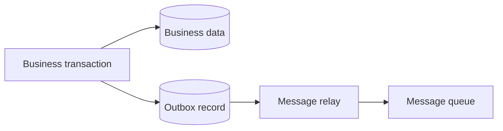

## Problem

一个业务操作需要同时：

1. 写入数据库；
2. 向消息系统发布事件。

如果数据库提交后消息发送失败，就会出现业务状态已经改变、事件却永久丢失的 Dual Write 问题。反过来，在事务中间先发消息，也不能保证事务最终提交。使用分布式事务（2PC）通常不可行：数据库或消息代理可能不支持，也不希望服务与两者强耦合。

## Key Terms

| 中文 | English | 含义 |
| --- | --- | --- |
| 事务性发件箱 | Transactional Outbox | 在同一事务里写业务数据和待发布消息 |
| 双写 | Dual Write | 同时写数据库和消息系统，其中一步可能失败 |
| 消息中继 | Message Relay | 读取 Outbox 并发送到消息代理的组件 |
| 轮询发布 | Polling Publisher | 定期查询 Outbox 表中未发布的消息 |
| 事务日志尾随 | Transaction Log Tailing | 读取数据库事务日志来发布消息 |
| 两阶段提交 | 2PC（Two-Phase Commit） | 跨数据库和消息代理的分布式事务 |

## Pattern

在同一个数据库事务中写入业务记录和 Outbox 记录。独立的 Message Relay 再读取 Outbox 并发送消息。

关系型数据库中，Outbox 通常是一张表；NoSQL 数据库中，也可以是每条记录上的一个属性。

## Two Ways to Relay

| 方式 | 做法 | 优点 | 缺点 |
| --- | --- | --- | --- |
| Polling publisher | 后台进程定期查询 Outbox 表中未发布的消息，发布后标记 | 适用于任何 SQL 数据库 | 按顺序发布较棘手；并非所有 NoSQL 数据库都支持 |
| Transaction log tailing | 读取数据库事务日志（MySQL binlog、Postgres WAL、DynamoDB Streams 等），把插入 Outbox 的记录发布出去 | 延迟更低，结果准确 | 依赖具体数据库；相对少见；避免重复发布较棘手 |

## Guarantees and Limits

- 当且仅当数据库事务提交时，消息才会被发送；消息可按应用写入的顺序发布。
- Relay 仍可能重复发布：例如发布后、记录“已发布”之前崩溃，重启后会再发一次。所以消费者仍需 [[Idempotency|幂等]]，例如记录已处理的消息 ID。
- 开发者可能忘记在更新数据库后写 Outbox，需要把两者封装在一起。
- 需要跟踪发布状态、延迟、积压和重放。
- 使用数据库变更流时，也不能默认跨记录的事务事件会以原子批次呈现给消费者，见 [[Amazon DynamoDB]]。

## Connections

### Solves
- Dual Write
- [[Reliable Asynchronous Processing]]

### Depends on
- [[Transaction Isolation]]
- [[Delivery Semantics]]

### Implementation
- [[Amazon DynamoDB]]

## Sources

- [microservices.io — Transactional outbox](https://microservices.io/patterns/data/transactional-outbox.html)
- [microservices.io — Polling publisher](https://microservices.io/patterns/data/polling-publisher.html)
- [microservices.io — Transaction log tailing](https://microservices.io/patterns/data/transaction-log-tailing.html)
