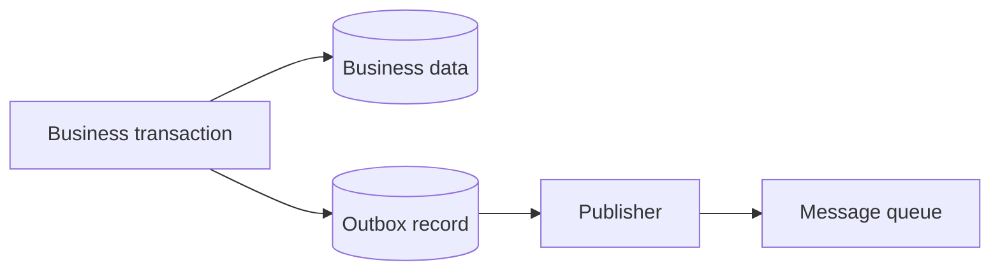

## Problem

一个业务操作需要同时：

1. 写入数据库；
2. 向消息系统发布事件。

如果数据库提交后消息发送失败，就会出现业务状态已经改变、事件却永久丢失的 Dual Write 问题。

## Pattern

在同一个数据库事务中写入业务记录和 Outbox 记录。独立 Publisher 再读取 Outbox 并发送消息。

## Guarantees and Limits

- 业务记录与待发布事件能够一起提交。
- Publisher 仍可能重复发布，所以消费者仍需 [[Idempotency|幂等]]。
- 需要跟踪发布状态、延迟、积压和重放。
- 使用数据库变更流时，也不能默认跨记录的事务事件会以原子批次呈现给消费者。

## Connections

### Solves
- Dual Write
- [[Reliable Asynchronous Processing]]

### Depends on
- [[Transaction Isolation]]
- [[Delivery Semantics]]

### Implementation
- [[Amazon DynamoDB]]

