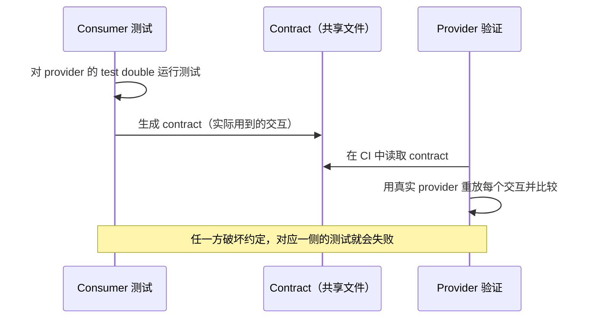

## Definition

Contract Test 验证系统边界两侧对协议的理解一致。Contract 不只包括 JSON schema，还包括 method、path、headers、status code、field semantics、ordering、compatibility 和 error behavior。

Pact 的定义：contract testing 是通过让每个应用单独检查“它发送或接收的消息是否符合一份共享的、文档化的 contract”来测试集成点的技术。对 HTTP 应用，“消息”就是 request 和 response；对用队列的应用，就是放进队列的消息。

## Key Terms

| 中文 | English | 含义 |
| --- | --- | --- |
| 契约测试 | Contract Test | 验证边界两侧对协议的理解一致 |
| 消费者 / 提供者 | Consumer / Provider | 需要数据的一方 / 提供数据的一方 |
| 消费者驱动契约 | Consumer-Driven Contract | 由消费者声明依赖的交互，提供者验证它们 |
| 举例的契约 | Contract by Example | 契约由具体的 request/response 例子组成 |
| 模式校验 | Schema Validation | 校验消息是否符合静态的 schema 或规范 |
| 兼容性 | Compatibility | 新旧版本能否共存 |
| 测试替身 | Test Double | 被消费者测试用来替代 provider 的对象 |

## Contract Surface

| Surface | Example |
| --- | --- |
| Transport | HTTP method、path、content type |
| Shape | required fields、types、nullable rules |
| Semantics | `completed` 的含义、timestamp 单位 |
| Errors | status code、retryability、error body |
| Compatibility | 新旧 producer/consumer 是否可共存 |
| Security | required claims、scope、tenant context |

只验证 response 能被 JSON parser 解析，不能证明双方理解了同一个业务含义。

## Consumer-Driven Flow



Pact 的做法：contract 在 consumer 的自动化测试执行过程中生成，只有 consumer 实际用到的通信部分被测试，因此 provider 上没被任何 consumer 使用的行为可以放心改动。实现方式是确认对 test double 的调用，与对真实应用的调用返回相同的结果。

## Common Forms

- **Schema validation**：请求和响应符合 OpenAPI、JSON Schema、Protobuf 等定义。Pact 指出，schema 或规范（如 OAS）是描述资源所有可能状态的静态产物，而 Pact 的 contract 是通过执行一组测试用例来强制的，每个用例描述一个具体的 request/response 对，是“举例的契约”；两者相关但不相同。
- **Consumer-driven contract**：consumer 声明它依赖的交互，provider 在 CI 验证这些 expectation。
- **Provider contract test**：provider 验证对外公开的输入、输出和错误行为，即确保提供者的实际行为符合其文档化的 contract（例如 OpenAPI 文档）。
- **Compatibility test**：验证旧 consumer 与新 provider，或新 consumer 与旧 provider 的可共存性。

## Example: Graph Output to API Event

Graph 输出：

```text
requires_clarification = true
```

API event：

```text
event.type = clarification_required
```

语义判断是否正确主要属于 graph/component evaluation；contract test 负责验证已知 graph 输出能够稳定映射成正确 event，包括字段名、payload 和版本兼容。

## Contract Test vs API E2E

Contract test 可以快速穷举缺失 header、额外字段、错误码和版本组合。[[End-to-End Test]] 只需保留少量真实请求，确认 gateway、deployment、authentication 和 storage 没有破坏契约。

对于 API Gateway，直接调用 Lambda 的测试不能覆盖：

- request/response mapping；
- header forwarding 或 removal；
- authorizer 与 route selection；
- gateway-generated error；
- binary、encoding 或 payload limit。

这些行为需要经过真实 gateway 的 integration/contract coverage。

## Compatibility Heuristics

- 新增 optional field 通常比删除或重命名字段安全。
- Consumer 应忽略未知字段，除非协议明确禁止。
- Producer 不应在没有版本策略时改变既有字段语义。
- Event-driven system 要考虑旧消息仍在 queue 中、新旧 worker 同时运行的窗口。

## Gotchas

- Contract test 通过不代表业务流程一定完成。
- 只生成 schema 但不在 CI 执行验证，schema 会逐渐与实现漂移。
- 过度指定字段顺序、内部 metadata 等非契约细节，会制造脆弱测试。
- Mock server 只有在由同一份 contract 生成或校验时才可信。

## Connections

### Describes boundaries from
- [[OpenAPI Specification]]
- [[API Endpoint]]
- [[Static and Parameterized API Paths]]

### Complements
- [[Integration Test]]
- [[End-to-End Test]]

### Protects
- [[Reliable Asynchronous Processing]]
- [[API Gateway]]

## Sources

- [Pact Docs — Introduction and contract testing terminology](https://docs.pact.io/)
- [Martin Fowler — Integration Test (narrow integration tests and contract tests)](https://martinfowler.com/bliki/IntegrationTest.html)
