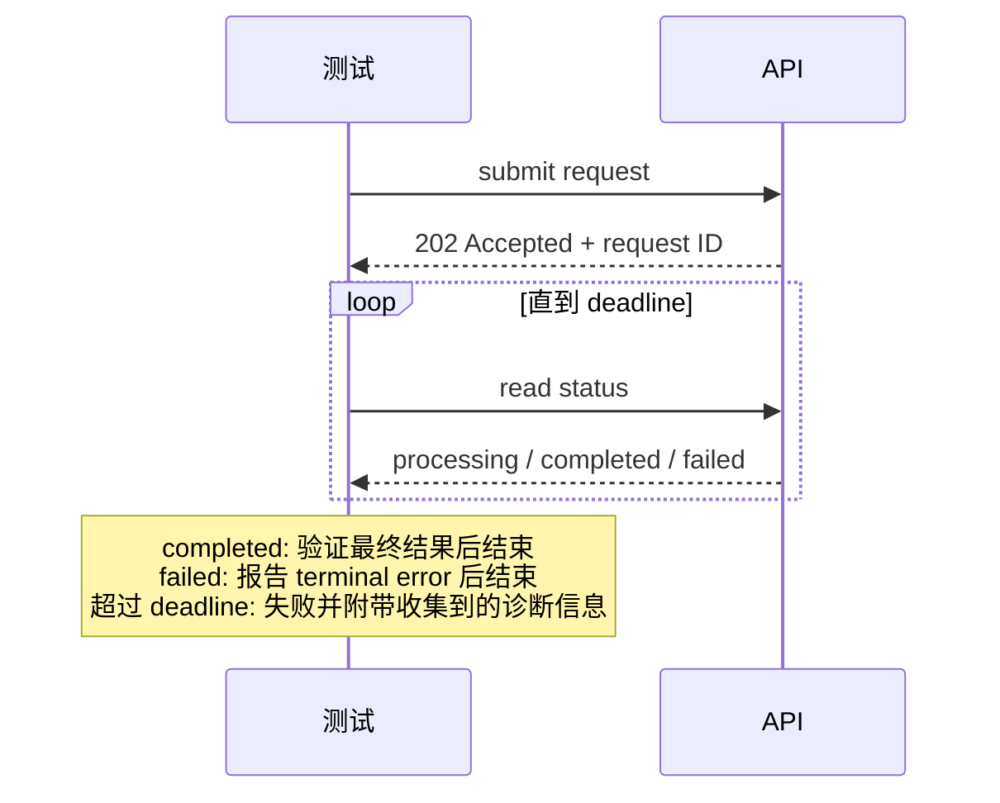

## Definition

End-to-End Test（E2E Test）从真实入口驱动一条完整业务或用户链路，并验证最终可观察结果。它保护的是跨组件协作，而不是穷举每个内部模块的所有边界情况。

E2E 不一定从浏览器开始。对于异步 API 产品，`submit request → worker processing → result persistence → polling completed` 本身就是系统级 E2E。

## Key Terms

| 中文 | English | 含义 |
| --- | --- | --- |
| 端到端测试 | End-to-End Test（E2E） | 从真实入口驱动完整链路并验证最终结果 |
| 系统测试 | System Test | Fowler 对 broad integration test 的另一个叫法 |
| 轮询 | Polling | 反复查询状态直到结束 |
| 截止时间 | Deadline | 测试等待的最长时间 |
| 关联 ID | Correlation / Request ID | 把一次请求在各服务里的记录串起来 |
| 可诊断性 | Diagnosability | 失败后能快速定位原因 |
| 脆弱测试 | Flaky Test | 同样代码有时过有时不过 |

## What E2E Uniquely Proves

- 部署后的组件能够被正确连接；
- identity、tenant、configuration 和 feature flag 正确传播；
- queue、worker、database、API 等真实边界能够协作；
- 最终结果确实能从用户入口提交，并从用户出口读取；
- production-like environment 中没有被 mocks 隐藏的 wiring 问题。

## What It Should Not Own

- 每个 parser 的全部边界值；
- 每个 graph node 的所有语义样例；
- 所有 API field 的组合；
- 完整负载容量；
- 仅在内部实现中有意义的调用顺序。

这些行为通常应由 [[Unit Test]]、[[Integration Test]] 或 [[Contract Test]] 更便宜地覆盖。

Google 的工程经验解释了原因：端到端测试要等整个产品构建、部署之后才能运行，运行时脆弱测试（flaky test）几乎是常态，而且即使发现了 bug，也可能出在产品的任何地方，找到根因很痛苦。flaky test 会降低开发者对测试的信任，于是常被忽略，哪怕它发现了真正的问题。所以只应保留少量端到端测试来验证系统整体。

## Selecting E2E Scenarios

优先保留：

1. 最关键的 happy path；
2. 一个重要业务分支；
3. 权限或 tenant isolation；
4. 关键失败与恢复路径；
5. 曾在 production 发生、且只能跨组件复现的问题。

每个场景都应能说明它跨越了哪些真实边界，以及为什么较低层测试不能提供同等证据。

## Asynchronous Systems

异步 E2E 应使用 deadline 和 observable condition，而不是固定 sleep：



```text
submit request
repeat until deadline:
    read status
    if completed: verify final result and stop
    if failed: report terminal error and stop
fail with collected diagnostics
```

客户端发现完成的时间包含 polling interval，不等于服务端实际完成时间。测试结果应区分：

- request acceptance latency；
- server completion latency；
- client-observed completion latency。

## Diagnosability

E2E failure 很难仅靠最终 assertion 定位。测试至少应记录：

- correlation/request ID；
- 部署版本与配置版本；
- 每个外部阶段的开始和结束时间；
- terminal status 与可安全记录的错误分类；
- 对应 trace 或服务端日志入口。

不要把敏感 payload 直接写入测试日志。

## Gotchas

- 只检查最终 HTTP 200，无法证明异步工作真正完成。
- 把所有内部 node 顺序写进 E2E assertion，会让合法重构造成大量无意义失败。
- 通过增加 sleep 掩盖 race condition，会让 suite 更慢但不更可靠。
- E2E 通过只证明所选场景在该环境成功，不代表容量、安全和所有兼容组合都已验证。
- UI E2E 与 API E2E 可以分别存在；前者保护用户交互，后者保护后端交付链路。

## Connections

### Positioned in
- [[Test Pyramid]]

### Designed through
- [[Risk-Based Test Design]]
- [[Test Oracle]]

### Complements
- [[Unit Test]]
- [[Integration Test]]
- [[Contract Test]]

### Observed through
- [[Observability]]
- [[Latency Percentiles]]

## Sources

- [Google Testing Blog — Just Say No to More End-to-End Tests](https://testing.googleblog.com/2015/04/just-say-no-to-more-end-to-end-tests.html)
- [Martin Fowler — Integration Test (broad integration tests)](https://martinfowler.com/bliki/IntegrationTest.html)
- [Ham Vocke — The Practical Test Pyramid](https://martinfowler.com/articles/practical-test-pyramid.html)
