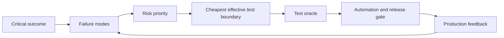

## Definition

Risk-Based Test Design 根据失败的 likelihood、impact 和 detectability 分配测试投入。目标不是穷尽所有测试名称，而是优先为最重要、最容易发生且最难被其他机制发现的风险建立证据。

## Workflow

1. 列出关键业务结果与不可接受的损失。
2. 对每个结果分析 failure mode，而不是只列代码模块。
3. 评估影响、发生概率、可发现性和恢复成本。
4. 选择能捕获风险的最低成本边界。
5. 定义明确的 [[Test Oracle]] 和失败诊断信息。
6. 决定运行频率：每次 commit、PR、nightly、pre-release 或 production sampling。

## Risk Matrix

| Risk | 典型主测试层 | 原因 |
| --- | --- | --- |
| 纯函数计算错误 | [[Unit Test]] | 快速、确定、定位直接 |
| Database mapping 或 transaction 错误 | [[Integration Test]] | 需要真实 driver、schema 和 transaction behavior |
| Producer 与 consumer 字段理解不一致 | [[Contract Test]] | 风险位于边界协议 |
| 完整异步任务不能交付结果 | [[End-to-End Test]] | 风险来自跨组件真实协作 |
| 高并发下超时或资源耗尽 | Load/performance test | 功能样例无法代表容量风险 |
| 新版本部署后指标恶化 | [[Canary Deployment]] + [[Observability]] | 需要受控真实流量和回滚门槛 |

## Primary Ownership by Layer

一条业务规则应有一个主要测试层，其他层只验证它们新增的风险。

例如，某个分类规则的语义正确性主要由 unit/component tests 覆盖；API E2E 不需要重复所有分类样例，而是验证正确结果能够经过 serialization、storage 和 delivery 到达客户端。

判断某一层是否值得新增测试时，问：

> 如果上游结果已经确定正确，这一层还能出什么错？

能明确回答的错误，就是该层应该保护的风险。

## Senior Engineering Heuristics

- **Optimize for confidence per maintenance cost**，不是测试数量。
- 高风险边界应有多个互补证据，但不要复制同一个 assertion。
- Code coverage 只说明代码被执行，不说明重要行为被正确验证。
- Flaky test 会消耗团队对整套 suite 的信任，应被当作产品级缺陷治理。
- 测试无法穷尽未知风险；需要结合 [[Observability]]、渐进式发布和 incident learning。
- 测试组合应随着架构、流量、依赖和故障历史变化，而不是一次设计后永久固定。

## Gotchas

- 机械追求 100% coverage，可能让低价值断言挤占高风险场景。
- 只测试 happy path 会遗漏 timeout、retry、duplicate、partial failure 和权限隔离。
- 只按组织边界分配测试，容易让跨团队 contract 成为无人负责的空白区。
- 将所有真实依赖都替换为 mock，会让 suite 对部署和配置错误失明。

## Connections

### Structured by
- [[Test Classification Dimensions]]
- [[Test Pyramid]]

### Depends on
- [[Test Oracle]]
- [[Data Invariant]]

### Complements
- [[Observability]]
- [[Canary Deployment]]

