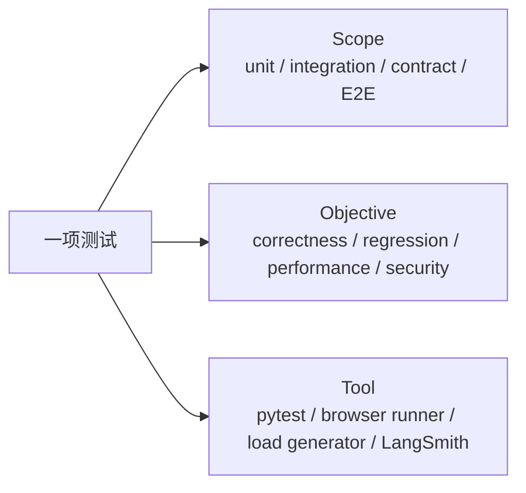

## Definition

Test Classification Dimensions 指用多个彼此独立的维度描述一项测试，而不是把所有测试名称放进同一个互斥分类。最实用的三个维度是 **test scope、validation objective 和 execution tool**。

## Key Terms

| 中文 | English | 含义 |
| --- | --- | --- |
| 测试范围 | Test Scope | 执行时跨过多少组件和边界 |
| 验证目标 | Validation Objective | 这次运行想发现哪种退化或风险 |
| 执行工具 | Execution Tool | 用什么运行、记录或分析测试 |
| 测试大小 | Test Size | 按资源限制（网络、数据库、时间）划分的 Small / Medium / Large |
| 回归测试 | Regression Test | 保证已有行为未被改坏的测试，不是独立层级 |
| 基准测试 | Benchmark | 衡量性能的测试 |

## Three Dimensions

| Dimension | 回答的问题 | Examples |
| --- | --- | --- |
| Test scope | 执行时跨过多少组件和边界？ | [[Unit Test]]、[[Integration Test]]、[[Contract Test]]、[[End-to-End Test]] |
| Validation objective | 这次运行想发现哪种退化或风险？ | correctness、regression、performance、security、reliability |
| Execution tool | 用什么运行、记录或分析？ | pytest、browser runner、load generator、LangSmith |

这三个维度可以自由组合。例如：

> “pytest 执行的 graph-level regression test，并把 trace 和评分记录到 LangSmith。”

这里 pytest 是 runner，regression 是目标，graph-level 是范围（对 LangGraph 工作流整体的测试），LangSmith 是实验与 trace 平台。

## Another Axis: Test Size

Google 用资源限制来给测试分级，称为 Small、Medium、Large：

| 特性 | Small | Medium | Large |
| --- | --- | --- | --- |
| 网络访问 | 否 | 仅 localhost | 是 |
| 数据库 | 否 | 是 | 是 |
| 时间限制 | 60 秒 | 300 秒 | 900 秒以上 |

Google 的说法：Small 大致等价于 unit test，Large 等价于 end-to-end 或 system test，Medium 是验证两层之间能否通信的 integration test。这种分级的好处是工具能强制执行这些限制。它是按**资源**划分，与按**范围**划分是不同的维度，二者经常对应但并不总是一一对应。

## Why This Matters

如果把工具误当成测试层级，就容易产生虚假的二选一：

- “这是 pytest test，还是 LangSmith test？”
- “这是 E2E，还是 regression？”
- “这是 unit test，还是 benchmark？”

这些问题往往可以同时成立。真正需要避免的是：两个测试通过同一个入口读取同一个输出、执行同一个判断，却只因为工具不同而维护两份实现。

## A Precise Naming Pattern

讨论测试时，可以使用：

`[scope] + [objective] + [target] + [environment]`

例如：

- component-level correctness test for the reranker in CI
- API-level compatibility test against staging
- system-level latency benchmark under controlled load
- browser E2E regression test for the critical checkout path

这种描述比“我们有一个自动化测试”更能说明覆盖范围和缺口。

## Gotchas

- 文件名包含 `unit` 不代表它真的隔离、快速或确定。
- 调用真实 LLM、database 或 network 的单节点测试，通常已经是 component/integration test。
- 在 production-like environment 执行，不会自动让一项测试成为 E2E；仍要看它经过的实际边界。
- Regression 不是独立层级；任何稳定测试都可以进入 regression suite。

## Connections

### Organizes
- [[Test Pyramid]]
- [[Risk-Based Test Design]]

### Uses
- [[Test Oracle]]

## Sources

- [Google Testing Blog — Test Sizes](https://testing.googleblog.com/2010/12/test-sizes.html)
- [Kent C. Dodds — The Testing Trophy and Testing Classifications](https://kentcdodds.com/blog/the-testing-trophy-and-testing-classifications)
- [Martin Fowler — Unit Test](https://martinfowler.com/bliki/UnitTest.html)
