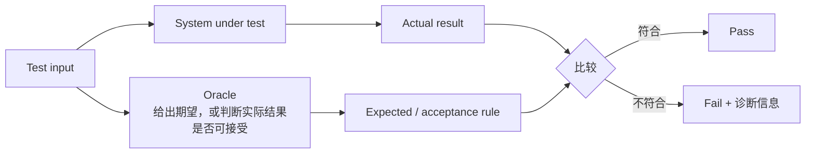

## Definition

Test Oracle 是判断某次执行结果是否可接受的依据。测试代码负责运行 system under test，而 oracle 回答“为什么这个结果算正确”。

没有可信 oracle 的测试，即使执行了大量路径，也只能证明系统运行过，不能证明行为正确。

## Key Terms

| 中文 | English | 含义 |
| --- | --- | --- |
| 测试预言 | Test Oracle | 描述给定输入下正确输出的信息来源 |
| 预言问题 | Oracle Problem | 确定某个输入对应的正确输出本身就很难 |
| 被测系统 | SUT（System Under Test） | 被测试的对象 |
| 不变量 | Invariant | 结果必须始终满足的约束 |
| 伪预言 | Pseudo-Oracle | 另一个独立编写、可对比输出的程序 |
| 变形关系 | Metamorphic Relation | 输入按已知方式变化时，输出应满足的对应关系 |
| 差分测试 | Differential Testing | 与旧实现或另一实现比较 |
| 变异测试 | Mutation Testing | 给程序植入小改动，检查测试能否发现 |
| 基于性质的测试 | Property-Based Testing | 对大量生成的输入验证通用性质 |

## How a Test Uses an Oracle

“test oracle” 一词最早由 William E. Howden 提出。Oracle 可以独立于 SUT 在测试运行时访问，也可以事先把期望结果编码进测试逻辑。

## Common Oracle Types

| Oracle | 判断方式 | 适用场景 |
| --- | --- | --- |
| Exact expected value | 实际值必须等于 reference | 纯函数、serialization、固定格式 |
| Invariant | 结果必须始终满足约束 | 金额守恒、权限隔离、状态单向推进 |
| Property-based oracle | 对大量生成输入验证通用性质 | parser、排序、边界值和组合输入 |
| Differential oracle | 与旧实现或另一实现比较 | migration、compiler、算法替换 |
| Metamorphic relation | 输入按已知方式变化时，输出应满足对应关系 | 缺少唯一 expected answer 的系统 |
| Golden/reference data | 与人工审查的样例集合比较 | 搜索、推荐、LLM evaluation |
| Human or model judge | 根据 rubric 评分 | 开放式文本质量与主观标准 |

## Where These Fit in the Literature

Barr 等人对 1978 到 2012 年文献的综述把 oracle 分成 specified、derived、implicit、human 四类，并把 partial oracle 看作 specified 与 derived 的混合。上表的类型大致可以这样对应（这是我的归纳）：

| 文献中的类别 | 含义 | 对应上表 |
| --- | --- | --- |
| Specified | 来自形式化规格或模型 | exact expected value、invariant |
| Derived | 由系统的其他产物推导：文档、历史版本的执行结果 | differential（pseudo-oracle）、golden/reference data、regression suite |
| Partial（混合） | 只规定重要但不完整的性质 | metamorphic relation、property-based |
| Implicit | 依赖隐含假设，如程序崩溃一定是问题 | 崩溃、未捕获异常 |
| Human | 由人判断，可定量也可定性 | human or model judge |

注意 regression test suite 本质是 derived oracle：它假设旧版本的行为是正确的。

## Metamorphic Example

当没有唯一的正确答案时，可以验证输入变化后输出之间的关系。Metamorphic testing 由 T.Y. Chen 在 1998 年提出。例如测试订房网站：搜索某城市返回 1,671 条结果，这些结果是否正确完整？这是预言问题；但可以再加上价格或星级过滤条件搜索一次，结果应当是原结果的子集，这个关系不要求知道“正确的 1,671”。

## Oracle Quality

好的 oracle 应尽可能具备：

- **Relevant**：直接对应要保护的业务或技术要求。
- **Independent**：不要把 production implementation 原样复制到 expected calculation。
- **Stable**：实现重构但行为不变时不应大量失败。
- **Diagnostic**：失败能说明哪一条约束没有满足。
- **Versioned**：reference、schema 和规则变化时可以追溯。

## Example

假设异步任务允许状态：

`accepted → processing → completed | failed`

Oracle 不一定要求每次观察到完全相同的状态序列，因为 polling 可能跳过瞬时状态；但可以验证这些 invariant：

- terminal state 只能是 `completed` 或 `failed`；
- terminal state 之后不能回到 `processing`；
- request A 的结果不能被 request B 读取；
- `completed` 可见时，对应最终结果也必须可读取。

这种 invariant-based oracle 比把某一次运行日志当作唯一正确序列更稳健。

## The Oracle Problem

复杂系统经常不存在唯一正确答案：

- 多个文档都可能支持答案；
- 自然语言可以有多种正确表达；
- 并发执行的合法顺序不止一种；
- 新实现可能比旧 baseline 更好。

这时应把一个模糊的总分拆成多个可解释标准，例如 correctness、groundedness、format、latency 和 cost，而不是强迫所有输出完全相等。

## Checking the Oracle Itself

Oracle 自身也可能有 bug。Mutation testing 给程序植入小改动（mutant），如果测试在 mutant 上仍通过，说明测试（及其 oracle）没有发现这种错误，可以借此评估测试的质量。关键规则还需要人工审查或交叉实现。

## Gotchas

- Regex 适合验证格式和必需片段，不等于语义正确性。
- Baseline 表示旧版本实际表现，不一定代表理想答案。
- Mock 的返回值是测试输入安排，不是 production behavior 的证据。
- Implicit oracle 容易有假阳性：例如在自愈的容错系统里，进程崩溃不一定是需要优先处理的问题。

## Connections

### Uses
- [[Data Invariant]]

### Guides
- [[Unit Test]]
- [[Integration Test]]
- [[Contract Test]]
- [[End-to-End Test]]

### Designed through
- [[Risk-Based Test Design]]

## Sources

- [Wikipedia — Test oracle](https://en.wikipedia.org/wiki/Test_oracle)（综述 Barr et al., *The Oracle Problem in Software Testing: A Survey*, 2015）
- [Wikipedia — Metamorphic testing](https://en.wikipedia.org/wiki/Metamorphic_testing)
- [Wikipedia — Mutation testing](https://en.wikipedia.org/wiki/Mutation_testing)
- [Hypothesis — property-based testing](https://hypothesis.readthedocs.io/en/latest/)
