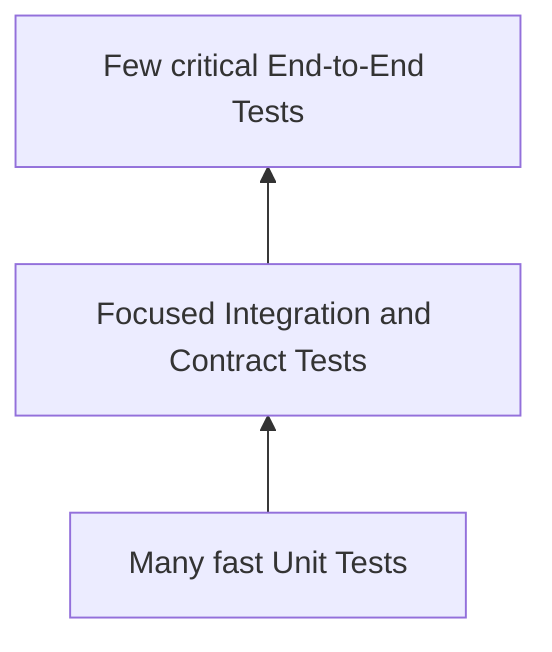

## Definition

Test Pyramid 是测试组合的成本模型：底层测试通常数量更多、运行更快、定位更清楚；越靠近完整系统，测试通常越慢、越脆弱、维护成本越高，因此只保留能提供独特信心的代表性场景。

它是 heuristic，不是固定比例，也不是要求所有系统拥有相同形状。

## Trade-offs by Layer

| Layer | Feedback speed | Realism | Failure localization | Typical cost |
| --- | --- | --- | --- | --- |
| [[Unit Test]] | 最快 | 低到中 | 最清楚 | 低 |
| [[Contract Test]] | 快 | 中 | 边界清楚 | 低到中 |
| [[Integration Test]] | 中 | 中到高 | 通常可控 | 中 |
| [[End-to-End Test]] | 慢 | 最高 | 较困难 | 高 |

越接近真实系统，不代表测试自动更“高级”。高级工程能力体现在：把风险放到最便宜且仍可信的层级验证，同时保留少量真实链路证据。

## Why the Shape Can Change

不同架构可能形成不同组合：

- CRUD service 可以大量依赖 integration tests，因为 database semantics 是核心风险。
- Event-driven system 需要加强 contract、idempotency 和 failure-recovery tests。
- UI-heavy product 可能采用 Testing Trophy：integration tests 占比更高。
- LLM application 往往需要 component/graph evaluation；它们不完全符合传统 unit test 的确定性假设。

所以“底层最多”表达的是成本与反馈原则，不是强制的测试数量 KPI。

## Avoiding Duplicate Coverage

同一业务规则可以跨层出现，但每层应保护不同风险：

| Layer | Example responsibility |
| --- | --- |
| Unit | 分类规则对输入的判断正确 |
| Integration | 分类结果被正确写入 state 或 database |
| Contract | 结果被正确转换成 API event |
| E2E | event 能经过真实链路到达用户 |

如果每层都重新运行全部分类样例并断言相同语义，通常是在复制维护成本，而不是增加有效覆盖。

## Gotchas

- 只有 unit tests 的 suite 可能对 schema、configuration 和 wiring 错误失明。
- 只有 E2E tests 的 suite 通常反馈慢、定位差，并容易受环境噪声影响。
- 用固定 sleep 缓解异步 flaky test 会掩盖 race condition；应等待可观察条件并设置明确 deadline。
- 测试数量不等于信心；一个保护关键 invariant 的测试可能比数百个浅层 assertion 更重要。

## Connections

### Organized by
- [[Test Classification Dimensions]]

### Shaped by
- [[Risk-Based Test Design]]

### Layers
- [[Unit Test]]
- [[Integration Test]]
- [[Contract Test]]
- [[End-to-End Test]]

