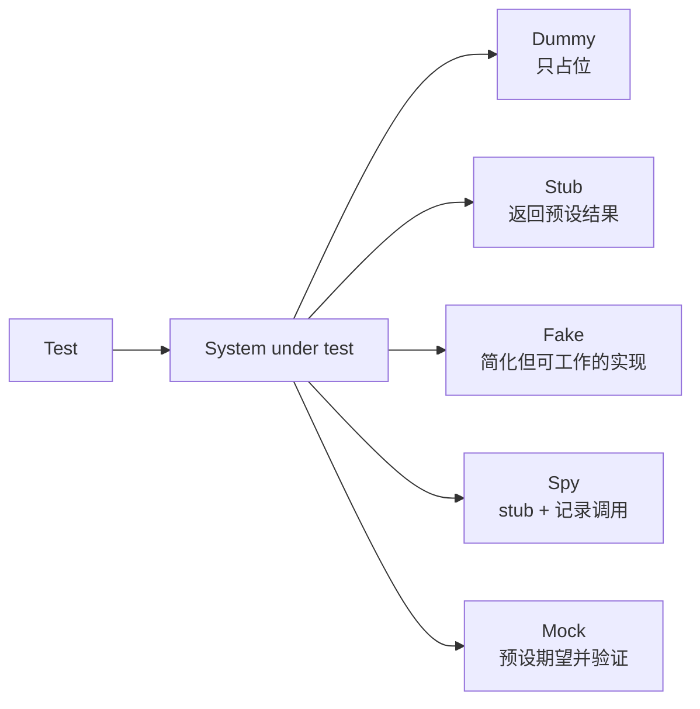

## Definition

Unit Test 隔离验证一个小范围行为。这里的 unit 不是固定等于一个 function 或 class，而是能够快速、确定地验证并在失败时清楚定位的最小有意义边界。

## Key Terms

| 中文 | English | 含义 |
| --- | --- | --- |
| 单元测试 | Unit Test | 隔离验证小范围行为的测试 |
| 测试替身 | Test Double | 测试里替代真实对象的统称 |
| 孤立 / 社交型单元测试 | Solitary / Sociable Unit Test | 用替身替换所有协作者 / 允许使用真实协作者 |
| 状态验证 | State Verification | 检查处理后的返回值或状态 |
| 行为验证 | Behavior Verification | 检查协作者是否以预期方式被调用 |
| 确定性 | Determinism | 相同输入和受控环境产生相同结果 |

## Desired Properties

- **Fast**：适合在本地和每次 CI 运行。
- **Deterministic**：相同输入与受控环境产生相同判断。
- **Isolated**：不依赖共享 network、clock、filesystem 或 mutable global state。
- **Behavior-focused**：验证外部可观察行为，而不是实现步骤。
- **Diagnostic**：失败信息指出哪个业务规则或 invariant 被破坏。

Fowler 指出，“unit test” 的共同点有两个：它们是低层的、聚焦于软件的一小部分；通常由程序员用常规工具编写。另一个更重要的区别是测试应该是 solitary 还是 sociable：solitary 测试用 test double 替代所有协作者，这样协作者的缺陷不会让当前类的测试失败；而 xUnit 早期实践里往往允许 sociable，除非协作者难以通信（例如远程的信用卡验证服务）。

## Good Candidates

- parsing、normalization 和 validation；
- state transition 与 reducer；
- permission decision；
- retry policy 的纯逻辑部分；
- serialization 前后的 deterministic mapping；
- ranking metric、Recall@k 等评分函数；
- bug fix 的最小复现。

## Test Doubles

| Double | 用途 |
| --- | --- |
| Dummy | 传来传去但从不真正使用，通常只用来填满参数列表 |
| Stub | 对测试中的调用返回预设的答案，通常不回应预设之外的调用 |
| Fake | 有可工作的实现，但走了捷径，不适合生产，例如 in-memory database |
| Spy | 是 stub，同时记录被如何调用，例如记录发了多少封邮件 |
| Mock | 预先声明期望收到的调用，收到意外调用时抛出异常，并在验证时检查是否收到所有预期调用 |

这套词汇来自 Gerard Meszaros，经 Martin Fowler 推广。Test double 应隔离不可控边界，而不是复制第三方系统的全部行为。越复杂的 fake，越需要自己的 contract/integration tests 证明它没有偏离真实系统。

## State-Based vs Interaction-Based

- **State-based testing** 检查输入处理后的返回值或状态，通常对重构更稳定。
- **Interaction-based testing** 检查某个 collaborator 是否以特定方式被调用，适合验证 side effect boundary，但容易与实现耦合。

Fowler 在 *Mocks Aren't Stubs* 里把前者称为 state verification、后者称为 behavior verification，并区分了 classical 与 mockist 两种测试风格。优先验证 observable outcome；只有调用本身构成 contract 时，才严格验证 interaction。

## Example

对于 retry delay，可以直接验证：

- attempt 增加时 delay 不减小；
- delay 不超过 cap；
- jitter 在允许范围内；
- non-retryable error 不产生下一次 delay。

不需要真的等待数秒，也不需要启动 worker。

## Gotchas

- Mock 所有 collaborator 可能让测试只证明 mocks 按脚本配合。
- 直接调用真实 database、LLM 或 HTTP endpoint 的测试通常不是 unit test。
- 对 private method 逐个测试会把实现结构固化成 contract。
- Flaky unit test 通常说明 clock、randomness、concurrency 或 global state 没有被控制。

## Connections

### Positioned in
- [[Test Pyramid]]

### Uses
- [[Test Oracle]]
- [[Data Invariant]]

### Complements
- [[Integration Test]]
- [[Contract Test]]

## Sources

- [Martin Fowler — Unit Test](https://martinfowler.com/bliki/UnitTest.html)
- [Martin Fowler — Test Double](https://martinfowler.com/bliki/TestDouble.html)
- [Martin Fowler — Mocks Aren't Stubs](https://martinfowler.com/articles/mocksArentStubs.html)
