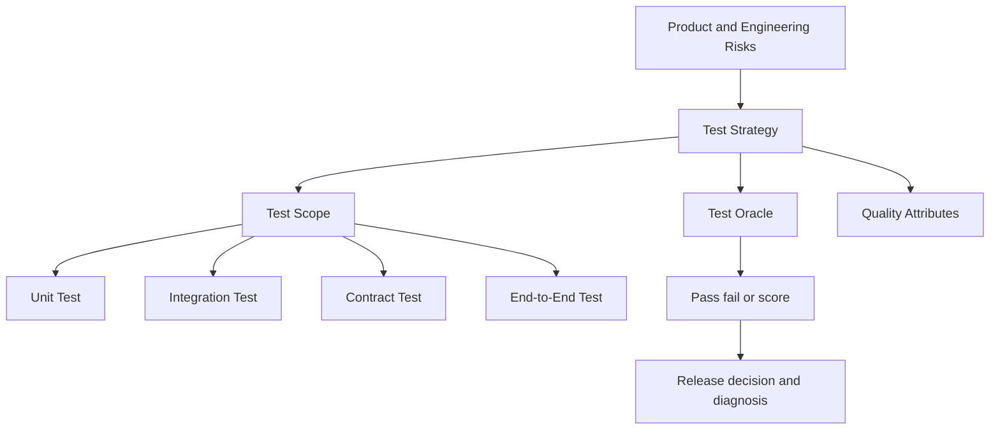

Software Testing 不是“写更多测试”，而是用可重复的证据降低软件变更的不确定性。一个成熟的 testing strategy 会同时考虑：需要保护什么风险、在哪个边界验证、用什么 oracle 判断，以及反馈需要多快返回。

## Mental Model

测试的价值不只在于发现 bug，也在于让团队敢于重构、升级依赖和改变部署方式。测试组合应在 **feedback speed、failure localization、realism、maintenance cost** 之间取得平衡。

## Foundations

- [[Test Classification Dimensions]]：区分测试范围、验证目标和执行工具。
- [[Risk-Based Test Design]]：从失败风险反推测试投入。
- [[Test Oracle]]：定义什么证据能够说明结果正确。
- [[Test Pyramid]]：理解不同测试层的数量、成本与反馈速度。

## Test Scopes

- [[Unit Test]]：隔离验证小范围逻辑。
- [[Integration Test]]：验证多个真实组件或基础设施之间的协作。
- [[Contract Test]]：验证边界两侧对同一协议的理解一致。
- [[End-to-End Test]]：验证完整用户或业务链路。

## Design Questions

设计一项测试前，先回答：

1. 这项测试保护哪一种失败风险？
2. 哪一层最靠近错误来源，并且能稳定观察该行为？
3. 如果上游输出已知正确，这一层还可能出什么错？
4. Oracle 来自 specification、invariant、reference data，还是人工判断？
5. 失败后能否快速判断是产品问题、环境问题还是测试问题？

## Connections

### Relies on
- [[Data Invariant]]
- [[Observability]]

### Applied to
- [[Reliable Asynchronous Processing]]
- [[API Endpoint]]
- [[Canary Deployment]]

